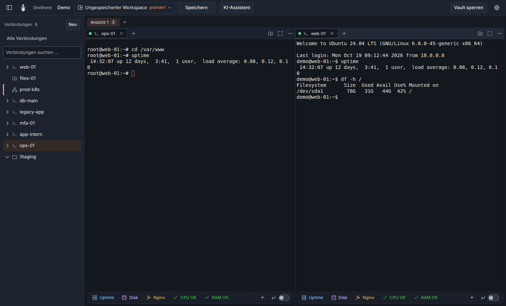
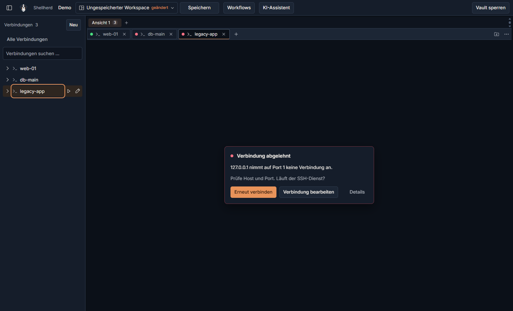
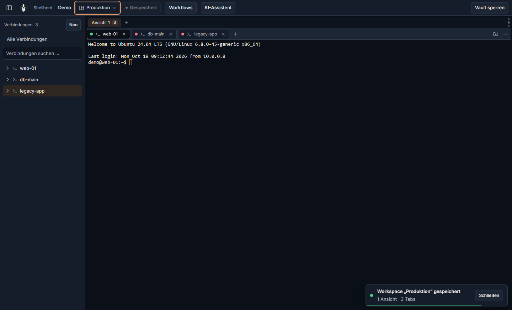
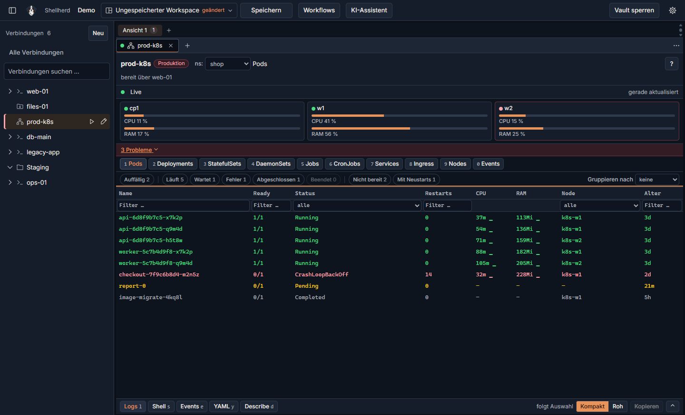
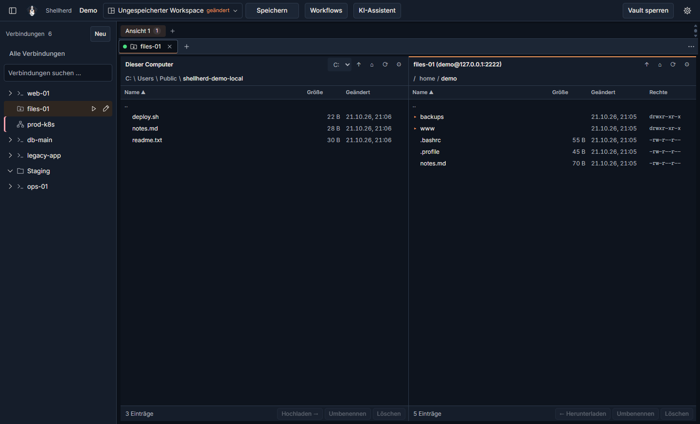
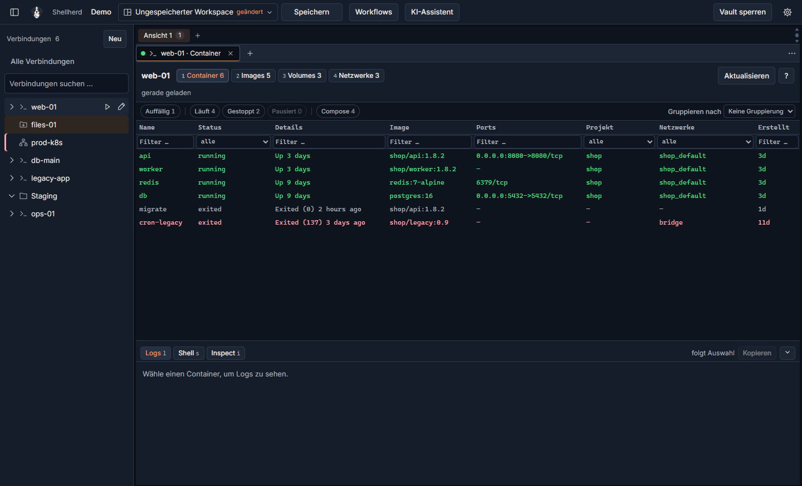
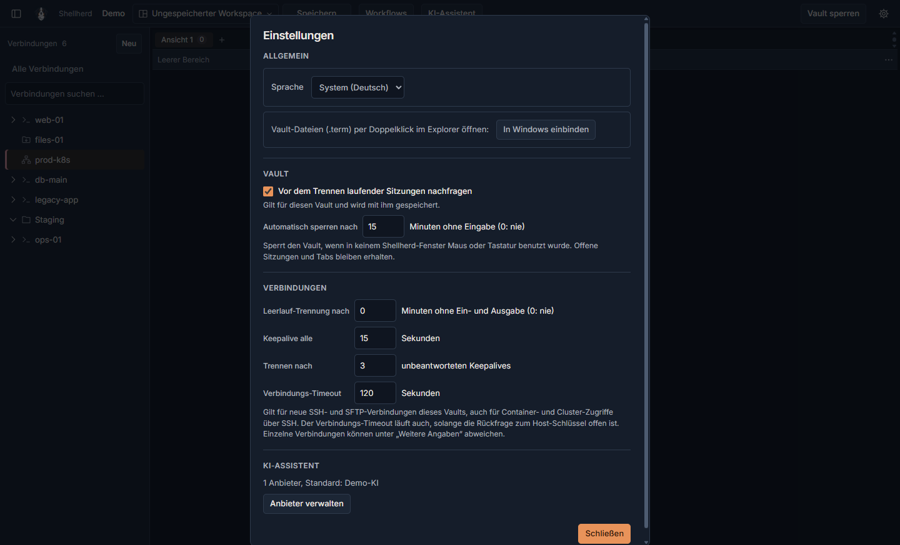
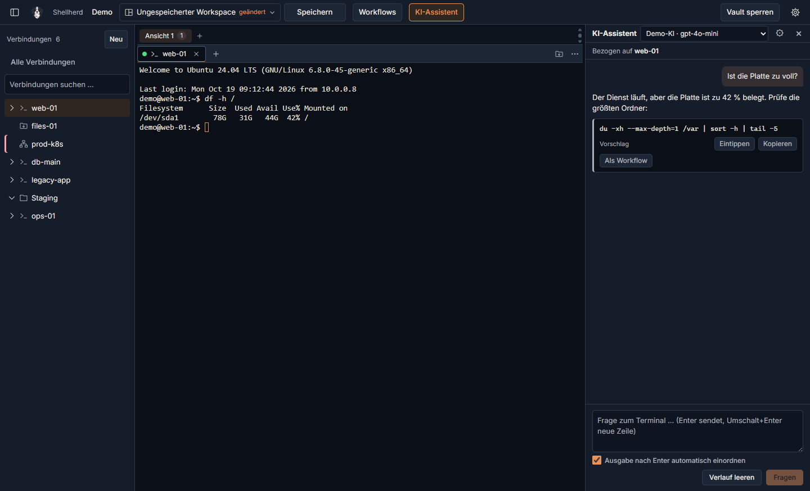

<div align="center">


# Shellherd

**A local, encrypted connection manager for SSH, RDP, containers and Kubernetes.**

[](https://github.com/pelmenipower/Shellherd/releases/latest)
[](https://github.com/pelmenipower/Shellherd/actions/workflows/ci.yml)

[](LICENSE)

[**Download**](https://github.com/pelmenipower/Shellherd/releases/latest) · [Changelog](CHANGELOG.en.md) · [Änderungen (German)](CHANGELOG.md) · [User guide (English)](docs/manual.md) · [Handbuch (German)](docs/handbuch.md)

</div>

<p align="center">
  
</p>

<table>
  <tr>
    <td width="50%"></td>
    <td width="50%"></td>
  </tr>
  <tr>
    <td align="center"><sub>Clear connection errors with the next step</sub></td>
    <td align="center"><sub>Notices that tell you what happened</sub></td>
  </tr>
</table>

Shellherd keeps all your servers, desktops and clusters in one window. Connections and their credentials live in a single encrypted vault file (`.term`) that you can carry around, back up or keep in sync – no account and no cloud service required.

## Features

- **SSH terminals** – up to 16 sessions as tabs, password, private key (with passphrase) or SSH agent, verified host keys.
- **Root shell and start commands** – per SSH connection, become root with `sudo -i` after login and type start commands, one line each.
- **Split views and workspaces** – drag tabs into up to four panes, rename tabs and views, and save the layout as a named workspace.
- **Remote Desktop (RDP)** – embedded in a tab, no extra install, including shortcuts like Ctrl+Alt+Del.
- **SFTP file browser** – two-pane, WinSCP style, with a transfer queue, edit-and-upload for remote files and Auto-Upload that mirrors a local folder to the server while the view is open. Transfers keep many requests in flight, resume where they stopped and can be verified by SHA-256 checksum. Text, configuration and source files open in their default program, everything else in Notepad, so a remote script never runs by accident.
- **Docker and Podman** – a container view per SSH host or for the local machine: containers, images, volumes and networks with filters, logs, shell and inspect.
- **Proxmox** – LXC containers and VMs under their host, with shell, serial console and power actions.
- **Kubernetes** – set up a cluster from an existing SSH connection; live nodes, workloads, pods and events with drill-down, logs, shell, YAML and describe. Production clusters ask you to type the resource name before any change.
- **German and English UI** – follows the Windows language by default; switch any time without a restart. Dates, numbers and sorting follow the language too.
- **Lock screen** – lock by hand or automatically after a set time without input; sessions keep running behind it and are back after unlocking. Idle disconnect, keepalive and connection timeout are set per vault and can be overridden per connection.
- **Settings in one place** – gear in the header or `Ctrl+,`: language, `.term` file association, confirmation before disconnecting, auto-lock, connection timeouts and the AI providers.
- **Local shells** – PowerShell and CMD tabs next to your remote sessions.
- **AI assistant** (optional) – reads the terminal, explains output and suggests the next command. Nothing reaches the terminal until you click **Type in**, and nothing runs until you press Enter. Works with OpenAI-compatible endpoints (including Ollama and LM Studio), Azure AI Foundry, Anthropic and Google Gemini.

## Screenshots

<p align="center">
  
</p>
<p align="center"><sub>Kubernetes: live nodes, workloads and pods; production clusters are clearly marked</sub></p>

<table>
  <tr>
    <td width="50%"></td>
    <td width="50%"></td>
  </tr>
  <tr>
    <td align="center"><sub>SFTP file browser: local folder and server side by side</sub></td>
    <td align="center"><sub>Docker containers per SSH host</sub></td>
  </tr>
  <tr>
    <td width="50%"></td>
    <td width="50%"></td>
  </tr>
  <tr>
    <td align="center"><sub>Settings in one place</sub></td>
    <td align="center"><sub>AI assistant: explains output and suggests the next command, nothing runs on its own</sub></td>
  </tr>
</table>

## Installation

Download the latest version from the [releases page](https://github.com/pelmenipower/Shellherd/releases/latest):

| File | Use it when |
|---|---|
| `Shellherd-Setup-x.y.z.exe` | You want a normal installation with Start menu entry. No admin rights needed. |
| `Shellherd-Portable-x.y.z.exe` | You want to run Shellherd without installing it, e.g. from a USB stick. |

The builds are not code-signed yet, so Windows SmartScreen may warn on first start. Choose **More info → Run anyway**.

**Requirements:** Windows 10 or 11 (x64).

## Security

- Vault files are encrypted with **AES-256-GCM**; the key is derived from your password with **Argon2id**. Saving writes the file to disk before it replaces the old one, so a crash cannot leave an empty vault.
- The renderer has no Node, file system or network access; everything sensitive stays in the main process.
- Server host keys must be confirmed once and are pinned afterwards; a changed key aborts the connection.
- File transfers never write outside the chosen folder: server file names that Windows cannot store safely are skipped. Overwrites keep the old file until the new one is complete, and uploads keep the file's permissions.
- Terminal output is never written to disk. Kubeconfigs stay in memory, the API tunnel only listens on `127.0.0.1`, and secrets are masked in YAML and inspect views.

Found a vulnerability? Please open a [private security advisory](https://github.com/pelmenipower/Shellherd/security/advisories/new) instead of a public issue.

## Development

Requires [Node.js](https://nodejs.org/) 24 and Windows (the RDP helper is compiled with the C# compiler that ships with .NET Framework 4.8).

```powershell
git clone https://github.com/pelmenipower/Shellherd.git
cd Shellherd
npm install
npm run dev
```

| Command | What it does |
|---|---|
| `npm run dev` | Start the app with hot reload |
| `npm run typecheck` | TypeScript checks for main and renderer |
| `npm test` | Run the test suite (Vitest) |
| `npm run dist` | Build installer and portable exe into `dist/` |
| `npm run drive` | Start the app under Playwright for automated clicking and screenshots |
| `npm run drive:sshd` | Local SSH/SFTP test server plus Kubernetes API and AI fakes, all synthetic, for `drive` |

### Driving the app (screenshots, UI checks)

[`.claude/skills/run-app/`](.claude/skills/run-app/SKILL.md) runs the built app under Playwright with an isolated profile, a synthetic demo vault and a local SSH test server, plus local fakes for SFTP, Docker, Kubernetes and the AI assistant. Native dialogs are stubbed, and real vaults and `%APPDATA%\Shellherd` are never touched. A small HTTP driver on `127.0.0.1:9333` accepts clicks, typing and screenshots. It writes a new token to `%TEMP%\shellherd-run\token` on every start and rejects requests without it, or from a browser, with 403:

```powershell
npx electron-vite build
npm run drive:sshd                              # second terminal
npm run drive                                   # third terminal
node .claude/skills/run-app/demo-setup.mjs      # demo vault with web-01, files-01, prod-k8s, Demo-KI, …
node .claude/skills/run-app/screens.mjs         # one screenshot per component (SFTP, containers, Kubernetes, settings, assistant, lock screen, start commands, …); --readme refreshes docs/images/
$token = Get-Content "$env:TEMP\shellherd-run\token"
curl.exe -H "x-driver-token: $token" "http://127.0.0.1:9333/ss?name=start&crop=status"
```

The skill file lists every driver command and the known pitfalls. Claude Code loads it as the `run-app` skill; the README screenshots were taken this way.

Built with Electron, TypeScript, React, xterm.js, ssh2 and the Kubernetes JavaScript client. UI rules are documented in [`docs/design-system.md`](docs/design-system.md).

### Branches

Feature branches merge into `staging` by pull request. `main` only receives pull requests from `staging`. It is protected: no direct pushes (admins included), CI must pass on an up-to-date branch, and force pushes and deletion are blocked. `staging` blocks force pushes and deletion.

### Releasing

1. On `staging`, bump the version: `npm run version:minor` (or `:patch` / `:major`).
2. Add a matching `## [x.y.z] – YYYY-MM-DD` section to both [`CHANGELOG.md`](CHANGELOG.md) (German) and [`CHANGELOG.en.md`](CHANGELOG.en.md) (English), with the same number of entries – the build and the tests fail otherwise.
3. Commit, push `staging` and open a pull request into `main`.
4. Merge it once CI is green.

On every push to `main`, the [release workflow](.github/workflows/release.yml) reads the version from `package.json`. If there is no tag `vX.Y.Z` yet, it runs the tests, builds both executables, creates the tag on the merged commit and publishes a GitHub release with both changelog sections as bilingual release notes. Merges that keep the version publish nothing.

## License

[MIT](LICENSE) © Alexander Schmidt
