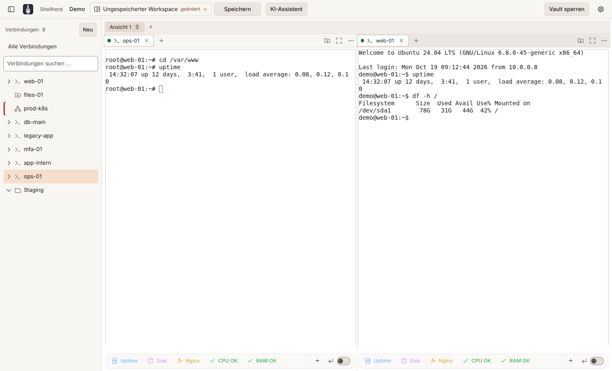
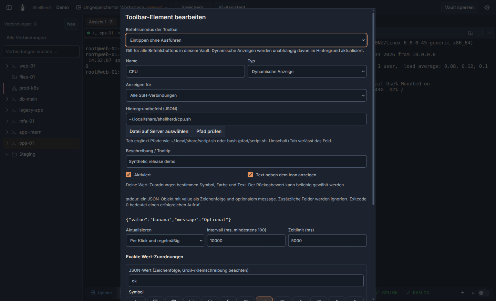

<div align="center">


# Shellherd

**A local, encrypted connection manager for SSH, RDP, containers and Kubernetes.**

[](https://github.com/pelmenipower/Shellherd/releases/latest)
[](https://github.com/pelmenipower/Shellherd/actions/workflows/ci.yml)

[](LICENSE)

[**Download**](https://github.com/pelmenipower/Shellherd/releases/latest) · [Changelog](CHANGELOG.en.md) · [Änderungen (German)](CHANGELOG.md) · [User guide (English)](docs/manual.md) · [Handbuch (German)](docs/handbuch.md)

</div>

<p align="center">
  
</p>

Shellherd keeps all your servers, desktops and clusters in one window. Connections and their credentials live in a single encrypted vault file (`.term`) that you can carry around, back up or keep in sync – no account and no cloud service required.

## New in 0.31.0

Windows and Linux now share the same release: Windows setup and portable EXEs, an Ubuntu/Debian DEB and a portable Linux AppImage, with installation scripts and SHA-256 checksums. On Linux, open local Bash, Zsh or Fish sessions alongside your SSH connections.

The new **SSH terminal toolbar** replaces the workflow palette. Pin commands, choose whether a click inserts or runs them, and add JSON-driven status displays for CPU, RAM or your own health checks. Previous workflow data stays in the vault; recreate the commands you need as toolbar buttons. [Set up CPU and RAM displays](#cpu-and-ram-toolbar-examples) or read the [full changelog](CHANGELOG.en.md#0310--2026-10-30).

## Features

- **SSH terminals** – up to 16 sessions as tabs, password, private key (with passphrase) or SSH agent, verified host keys. Two-factor sign-in prompts and one jump host per connection are supported.
- **Port forwards** – local, remote and SOCKS forwards per SSH connection, started and stopped from the terminal tab.
- **Root shell and start commands** – per SSH connection, become root with `sudo -i` after login and type start commands, one line each.
- **Split views and workspaces** – drag tabs into up to four panes, rename tabs and views, and save the layout as a named workspace.
- **Remote Desktop (RDP, Windows)** – embedded in a tab, no extra install, including shortcuts like Ctrl+Alt+Del.
- **SFTP file browser** – two-pane, WinSCP style (go to path, filter, hide dotfiles), with a transfer queue, edit-and-upload for remote files and Auto-Upload that mirrors a local folder to the server while the view is open. Transfers keep many requests in flight, resume where they stopped and can be verified by SHA-256 checksum. Edit remote files in a local text editor; remote scripts are opened as text.
- **Docker and Podman** – a container view per SSH host or for the local machine: containers, images, volumes and networks with filters, logs, shell and inspect.
- **Proxmox** – LXC containers and VMs under their host, with shell, serial console and power actions.
- **Kubernetes** – live nodes, workloads, pods and events through an existing SSH connection. Inspect YAML, describe resources, open shells, stream merged workload logs and forward pod or service ports to 127.0.0.1. RBAC pre-checks disable forbidden actions; production changes require typing the resource name.
- **Cluster diagnosis and GitOps links** – preview a read-only AI analysis of failing resources with masking always enabled and no Secrets read. Open matching resources in Argo CD or Harbor, and see a self-heal warning before changing an Argo CD managed resource.
- **German and English UI** – follows the system language by default; switch any time without a restart. Dates, numbers and sorting follow the language too.
- **Lock screen** – lock by hand or automatically after a set time without input; sessions keep running behind it and are back after unlocking. Idle disconnect, keepalive and connection timeout are set per vault and can be overridden per connection.
- **Settings in one place** – gear in the header or `Ctrl+,`: language, light or dark appearance, Windows `.term` file association, confirmation before disconnecting, auto-lock, connection timeouts and the AI providers.
- **SSH terminal toolbar** – customizable command buttons and JSON-driven dynamic displays, scoped to one connection or all SSH connections. Choose insert/execute mode, optional confirmation, icons, colors and exact value mappings. [CPU/RAM examples](#cpu-and-ram-toolbar-examples).
- **Terminal comfort** – search in the terminal with `Ctrl+Shift+F`, links opened with Ctrl+click (http and https only), tab shortcuts, a mark on background tabs with new output, input to all panes, and font, scrollback and cursor settings.
- **Local shells** – PowerShell and CMD on Windows; automatically detected Bash, Zsh and Fish on Linux.
- **Import** – connections from OpenSSH (`~/.ssh/config`), PuTTY, WinSCP and mRemoteNG, shown as a preview with checkboxes before anything is saved. Passwords are never imported; key files stay where they are and only their path is stored.
- **AI assistant** (optional) – reads the terminal, explains output and suggests the next command. Nothing reaches the terminal until you click **Type in**, and nothing runs until you press Enter. Works with OpenAI-compatible endpoints (including Ollama and LM Studio), Azure AI Foundry, Anthropic and Google Gemini.

## Screenshots

Captured from Shellherd 0.31.0 running on Linux with a synthetic vault and local demo services. CPU/RAM status values are simulated; screenshots contain no real infrastructure or credentials. [Reproduce the gallery](docs/images/README.md).

<table>
  <tr>
    <td width="50%"></td>
    <td width="50%"></td>
  </tr>
  <tr>
    <td align="center"><sub>Light theme, root shell and shared SSH toolbar</sub></td>
    <td align="center"><sub>Configure commands and dynamic displays per vault or connection</sub></td>
  </tr>
</table>

<p align="center">
  
</p>
<p align="center"><sub>Kubernetes: live nodes, workloads and pods; production clusters are clearly marked</sub></p>

<table>
  <tr>
    <td width="50%"></td>
    <td width="50%"></td>
  </tr>
  <tr>
    <td align="center"><sub>SFTP file browser: local folder and server side by side</sub></td>
    <td align="center"><sub>Docker containers per SSH host</sub></td>
  </tr>
  <tr>
    <td width="50%"></td>
    <td width="50%"></td>
  </tr>
  <tr>
    <td align="center"><sub>Settings in one place</sub></td>
    <td align="center"><sub>AI assistant: explains output and suggests the next command, nothing runs on its own</sub></td>
  </tr>
</table>

## Installation

Download the latest version from the [releases page](https://github.com/pelmenipower/Shellherd/releases/latest):

| File | Use it when |
|---|---|
| `Shellherd-Setup-x.y.z.exe` | You want a normal installation with Start menu entry. No admin rights needed. |
| `Shellherd-Portable-x.y.z.exe` | You want to run Shellherd without installing it, e.g. from a USB stick. |
| `Shellherd-x.y.z-amd64.deb` | You use Ubuntu/Debian and want desktop integration and dependency installation. |
| `Shellherd-x.y.z-x86_64.AppImage` | You want the portable Linux build; see the sandbox requirements below. |

The builds are not code-signed yet, so Windows SmartScreen may warn on first start. Choose **More info → Run anyway**.

**Supported platforms:** Windows 10/11 x64 and Linux x86_64 (Ubuntu 22.04/24.04 or newer with a graphical desktop). Linux packages include Electron and their native modules; end users do not need Node.js. Linux packages and the installation scripts are included starting with 0.31.0; older releases may contain only Windows executables.

### Windows installation

The setup EXE installs Shellherd for the current user and adds a Start menu entry. For releases from 0.31.0 onward, you can also paste this into **PowerShell**:

```powershell
& ([scriptblock]::Create((Invoke-RestMethod 'https://github.com/pelmenipower/Shellherd/releases/latest/download/install.ps1')))
```

The script downloads the latest setup EXE, verifies it against the release's `SHA256SUMS`, and opens the normal setup wizard. It requires Windows 10/11 x64 and PowerShell 5.1 or newer. No Node.js or administrator PowerShell session is needed. It does not change your execution policy or bypass SmartScreen.

To inspect the script first, download `install.ps1` from the release and open it in a text editor. A downloaded script can be run with a process-only execution-policy override:

```powershell
powershell.exe -NoProfile -ExecutionPolicy Bypass -File .\install.ps1
```

Optional: `-Version 0.31.0` selects a published version, `-Silent` runs the setup without its wizard, and `-InstallerPath .\Shellherd-Setup-0.31.0.exe` uses a trusted local build. Local EXEs are supplied by you and are not checked against release checksums.

**Availability:** The online installation commands require a published release of **0.31.0 or later** with the scripts, `SHA256SUMS` and matching packages. Preparing or merging a release branch alone does not publish these files; the Release workflow must finish successfully on `main`. Until then, use a local installer or an existing Windows download.

### Linux installation

For a published release of 0.31.0 or later, install the Linux DEB with:

```bash
curl -fsSL https://github.com/pelmenipower/Shellherd/releases/latest/download/install.sh | bash
```

The script downloads the DEB, verifies its SHA-256 checksum and installs it through APT, including dependencies and desktop integration. Only APT requests sudo privileges. No Node.js is required. The selected release must contain `install.sh`, `SHA256SUMS` and the Linux DEB (0.31.0 or later).

For a local build, use `bash ./install.sh --package ./dist/Shellherd-0.31.0-amd64.deb`.

For Ubuntu, the DEB is the recommended installation. Download the matching version and install it with APT so desktop libraries are resolved:

```bash
sudo apt install ./Shellherd-x.y.z-amd64.deb
shellherd
```

The package installs a Shellherd icon and application-menu entry. The installer configures Chromium's sandbox and, where supported, an application-specific AppArmor profile. Run Shellherd as your normal user.

For a portable AppImage:

```bash
chmod +x Shellherd-x.y.z-x86_64.AppImage
./Shellherd-x.y.z-x86_64.AppImage
```

The AppImage requires FUSE 2 (`libfuse2` on Ubuntu 22.04, `libfuse2t64` on newer Ubuntu), or it can be extracted with `--appimage-extract` and started using `squashfs-root/AppRun`. It requires working unprivileged user namespaces for Chromium's sandbox. Ubuntu installations that restrict these through AppArmor may refuse startup; use the DEB, whose fixed installation path supports the application-specific profile. Extraction alone does not solve a sandbox restriction. The launcher never falls back to disabling the sandbox.

Linux runtime libraries include GTK 3, NSS, ALSA, X11/Wayland support and a glibc-based x86_64 system. A desktop session is required. Bash, Zsh and Fish are offered only when executable on `PATH`. SSH agents use `SSH_AUTH_SOCK`; load keys into your session's agent before starting Shellherd. Docker/Podman must be installed and accessible to the current user for local integration. Kubernetes and Proxmox access continue through the configured SSH host.

### Updating Shellherd

**Linux (Ubuntu/Debian):** run the same installer again to install the latest published DEB:

```bash
curl -fsSL https://github.com/pelmenipower/Shellherd/releases/latest/download/install.sh | bash
```

This requires a published release with `install.sh`, `SHA256SUMS` and the DEB, just like the initial installation. If you have already downloaded the script, use `bash ./install.sh`.

**Local development build:** from the repository directory, install your freshly built DEB with:

```bash
bash ./install.sh --package ./dist/Shellherd-0.31.0-amd64.deb
```

Replace the filename if your build uses another version. The installer uses APT's `--reinstall`, so this also updates a local build whose version number has not changed. Local packages are supplied by you and are not verified against release checksums. The script does not build the app. After the installation completes, finish your sessions, fully close Shellherd and reopen it to load the updated app. Vault files are retained.

**Windows:** run the PowerShell installer again to download the latest published setup and open its wizard:

```powershell
& ([scriptblock]::Create((Invoke-RestMethod 'https://github.com/pelmenipower/Shellherd/releases/latest/download/install.ps1')))
```

**Portable builds:** download the new AppImage or portable EXE from the release, close the running app, and replace the old executable. The Linux shell installer installs the DEB; it does not replace an AppImage.

**Update notification in the app:** after unlocking, Shellherd checks GitHub for a newer stable release, at most once every 24 hours after a successful check. When one is available, the status bar displays its version. Click the hint to open the release notes or skip that version. You can disable the check under **Settings → General**. This is a notification, not an automatic download or installation. Unpublished local changes, builds with the same version number, drafts and prereleases do not trigger a notification.

### Platform limitations

- Embedded RDP and Windows Hello are available only on Windows. Linux RDP requests fail with a specific unavailable error, including connections in a vault copied from Windows. FreeRDP's stdin credential support was investigated, but embedded window management, certificate prompts and session lifecycle have not been implemented or validated; no credentials are passed to an external RDP process.
- Vault encryption and the `.term`/`.terminus` format are unchanged. Unlock transferred vaults with their password. Device-specific Windows Hello enrollment does not transfer. Update machine-specific private-key paths, working directories and auto-upload paths after moving a vault. New Linux shell entries are additive and require a version that understands those protocols.
- Remote file editing on Linux uses an installed graphical text editor: gedit, Kate, Mousepad, Xed or GNOME Text Editor. A missing editor produces a clear error. Files are opened as text instead of executing remote scripts through desktop associations.
- Windows registry imports (PuTTY/WinSCP) and the per-user Windows file-association setting remain Windows-specific. OpenSSH and mRemoteNG file import are portable. Proxmox remains an SSH-host integration, not a local Linux hypervisor adapter.
- Linux vault files and remote-edit temporary files are created with owner-only permissions. Linux paths and vault grants are case-sensitive; Windows path matching retains its existing behavior.

## CPU and RAM toolbar examples

Two ready-to-use Linux scripts show how a server-side command can drive an icon, color and text:

- [`examples/toolbar/cpu.sh`](examples/toolbar/cpu.sh): approximate CPU utilization across all logical CPUs, sampled over one second.
- [`examples/toolbar/ram.sh`](examples/toolbar/ram.sh): RAM utilization based on `MemTotal - MemAvailable`, with used/total GiB in the tooltip.

They require Bash, AWK and a mounted Linux `/proc`; CPU sampling also uses `sleep`. They need no sudo, Node.js, Python, jq or extra monitoring packages, and make no system changes. These are machine-wide readings, not per-process measurements or container/cgroup quota readings. CPU sampling counts idle and I/O-wait time as idle. RAM uses available memory so reclaimable caches are not simply treated as unavailable RAM; see the [Linux `/proc` documentation](https://www.kernel.org/doc/html/latest/filesystems/proc.html).

### 1. Put the scripts on your Linux server

From a local checkout, replace `USER@HOST` with your SSH destination:

```bash
ssh USER@HOST 'mkdir -p "$HOME/.local/share/shellherd"'
scp examples/toolbar/cpu.sh examples/toolbar/ram.sh USER@HOST:.local/share/shellherd/
ssh USER@HOST 'chmod 700 "$HOME/.local/share/shellherd/cpu.sh" "$HOME/.local/share/shellherd/ram.sh"'
```

You can also upload the two files with Shellherd's SFTP browser and grant the owner execute permission. Test the scripts on the server:

```bash
~/.local/share/shellherd/cpu.sh
~/.local/share/shellherd/ram.sh
```

Typical output (your measurements will differ):

```json
{"value":"low","message":"CPU: 23.7% (1 second sample, all logical CPUs)","percent":23.7}
```

```json
{"value":"medium","message":"RAM: 75.0% (6.00 / 8.00 GiB used)","percent":75.0}
```

`value` selects your exact mapping. `message` supplies the tooltip. The additional numeric `percent` field demonstrates that extra JSON fields are allowed; Shellherd currently ignores it. Actual live percentages appear in the tooltip, while the icon and optional short text follow your mappings.

### 2. Add the displays in Shellherd

Open an SSH terminal, click `＋` in its toolbar, and create two **Dynamic display** items (**Dynamische Anzeige** in German):

| Setting | CPU example | RAM example |
|---|---|---|
| Name | `CPU` | `RAM` |
| Background command | `"$HOME/.local/share/shellherd/cpu.sh"` | `"$HOME/.local/share/shellherd/ram.sh"` |
| Refresh | On click and periodically | On click and periodically |
| Interval | `5000` ms | `5000` ms |
| Timeout | `3000` ms | `3000` ms |
| Scope | Current connection, or all SSH connections where you installed the script | Same |

**Choose file on server** opens a read-only SFTP file picker on the connected SSH server. Selecting a script inserts its absolute path with shell quoting; it does not upload or run the file. You can also type a path (`~/`, `$HOME/`, absolute or relative paths) and press **Tab** to complete it. **Shift+Tab** leaves the command field. Completion supports a direct script path or `bash /path/script.sh` / `sh /path/script.sh` with ordinary arguments; compound shell commands remain editable without path completion. **Check path** checks existence and Unix executable mode bits, without running the command. Effective permissions still depend on the remote user, ACLs and mounts. Browsing requires SFTP and an active SSH connection.

For each item, add these suggested mappings. Pick the actual symbols from the visual icon picker:

| Exact `value` | Example icon | Example color | Optional short text |
|---|---|---|---|
| `low` | Check mark | Green `#3fb950` | `CPU` or `RAM` |
| `medium` | Warning | Yellow `#d29922` | `CPU busy` or `RAM busy` |
| `high` | Stop | Red `#f85149` | `CPU high` or `RAM high` |

These are examples, not built-in meanings. Choose any icons, colors and texts you prefer. The commands and their JSON output stay out of the terminal; only your display and its tooltip update. Failed commands or invalid JSON produce a technical error with details in the tooltip.

### 3. Change the examples to suit your server

By default, the scripts return `low` below 70%, `medium` from 70% up to (but not including) 90%, and `high` from 90%. Customize the thresholds without editing either script:

```bash
env WARN_PERCENT=60 CRITICAL_PERCENT=85 "$HOME/.local/share/shellherd/ram.sh"
```

Use that same command in the toolbar's background-command field. Both variables must be integer percentages with `0 <= WARN_PERCENT < CRITICAL_PERCENT <= 100`. Change the script's returned strings and add matching mappings if you want different categories. Only the small JSON contract is fixed: one object on stdout, a string `value`, optional `message`, and exit code 0 after a successful reading. Diagnostics go to stderr with a nonzero exit code. CPU refreshes take at least one second, so choose an interval and timeout longer than that sample.

## Security

- Vault files are encrypted with **AES-256-GCM**; the key is derived from your password with **Argon2id**. Saving writes the file to disk before it replaces the old one, so a crash cannot leave an empty vault.
- The renderer has no Node, file system or network access; everything sensitive stays in the main process.
- Server host keys must be confirmed once and are pinned afterwards; a changed key aborts the connection.
- File transfers never write outside the chosen folder: server file names that Windows cannot store safely are skipped. Overwrites keep the old file until the new one is complete, and uploads keep the file's permissions.
- Terminal output is never written to disk. Kubeconfigs stay in memory, the API tunnel only listens on `127.0.0.1`, and secrets are masked in YAML and inspect views.

Found a vulnerability? Please open a [private security advisory](https://github.com/pelmenipower/Shellherd/security/advisories/new) instead of a public issue.

## Privacy

Shellherd makes no requests of its own besides these two. Connections you open (SSH, SFTP, containers, Kubernetes, RDP) go only to the hosts you configured. Argo CD and Harbor links open in your browser only after your click; Shellherd itself never contacts either.

- **AI providers** (optional): once you set one up, the assistant sends your questions and the terminal output it reads to the endpoint you chose.
- **Update check** (on by default): at most once a day, after unlocking, Shellherd asks GitHub for the latest release. The request contains only your IP address and `User-Agent: Shellherd/<version>`, nothing from the vault. Turn it off under Settings → General.

## Development

Requires [Node.js](https://nodejs.org/) 24. Windows builds compile RDP/Hello helpers with the .NET Framework 4.8 compiler. Linux skips those helpers and builds native modules on Linux.

On Ubuntu, install build prerequisites before `npm ci`:

```bash
sudo apt update
sudo apt install build-essential python3 libx11-dev libxkbfile-dev libgtk-3-0 libnss3
npm ci
npm run dev
npm run typecheck
npm test
npm run dist:linux
```

If an unpacked Electron development build reports a sandbox-helper error, its `chrome-sandbox` must be owned by root with mode 4755, or the system must permit Chromium's user-namespace sandbox. This requires an administrator; do not run Electron as root or add sandbox-disabling flags. Build output directories are recreated during packaging, so local helper permissions do not carry over. The installed DEB handles its own fixed-path sandbox setup.

`npm run dist:linux` produces AppImage and DEB in `dist/`; `npm run dist:win` produces the existing setup and portable EXEs on Windows. After a Linux build, `node scripts/smoke-linux.mjs` checks the packaged window, preload capabilities and renderer sandbox in a graphical session. An administrator may need to configure the unpacked helper first; CI can use `xvfb-run -a node scripts/smoke-linux.mjs`.

```powershell
git clone https://github.com/pelmenipower/Shellherd.git
cd Shellherd
npm install
npm run dev
```

| Command | What it does |
|---|---|
| `npm run dev` | Start the app with hot reload |
| `npm run typecheck` | TypeScript checks for main and renderer |
| `npm test` | Run the test suite (Vitest) |
| `npm run dist` / `npm run dist:win` | Build Windows installer and portable EXE into `dist/` |
| `npm run dist:linux` | Build Linux x86_64 AppImage and amd64 DEB into `dist/` |
| `npm run drive` | Start the app under Playwright for automated clicking and screenshots |
| `npm run drive:sshd` | Local SSH/SFTP test server plus Kubernetes API and AI fakes, all synthetic, for `drive` |

### Driving the app (screenshots, UI checks)

[`.claude/skills/run-app/`](.claude/skills/run-app/SKILL.md) runs the built app under Playwright with an isolated profile, a synthetic demo vault and a local SSH test server, plus local fakes for SFTP, Docker, Kubernetes and the AI assistant. Native dialogs are stubbed, links never open a browser, and real vaults and `%APPDATA%\Shellherd` are never touched. A small HTTP driver on `127.0.0.1:9333` accepts clicks, typing and screenshots. It writes a new token to `%TEMP%\shellherd-run\token` on every start and rejects requests without it, or from a browser, with 403:

```powershell
npx electron-vite build
npm run drive:sshd                              # second terminal
npm run drive                                   # third terminal
node .claude/skills/run-app/demo-setup.mjs      # demo vault with web-01, files-01, prod-k8s, Demo-KI, …
node .claude/skills/run-app/screens.mjs         # one screenshot per component (SFTP, containers, Kubernetes, settings, assistant, lock screen, start commands, …); --readme refreshes docs/images/
$token = Get-Content "$env:TEMP\shellherd-run\token"
curl.exe -H "x-driver-token: $token" "http://127.0.0.1:9333/ss?name=start&crop=status"
```

The skill file lists every driver command and the known pitfalls. Claude Code loads it as the `run-app` skill; the README screenshots were taken this way.

Built with Electron, TypeScript, React, xterm.js, ssh2 and the Kubernetes JavaScript client. UI rules are documented in [`docs/design-system.md`](docs/design-system.md).

### Branches

Feature branches merge into `staging` by pull request. `main` only receives pull requests from `staging`. It is protected: no direct pushes (admins included), CI must pass on an up-to-date branch, and force pushes and deletion are blocked. `staging` blocks force pushes and deletion.

### Releasing

1. Create a dedicated release branch from the current `origin/main` (or from `origin/staging` when preparing changes already staged). A separate worktree keeps other work isolated: `git worktree add -b release/0.31.0 ../shellherd-release origin/main`.
2. On that branch, bump the version with `npm run version:minor` (or `:patch` / `:major`). Add a matching `## [x.y.z] – YYYY-MM-DD` section to both [`CHANGELOG.md`](CHANGELOG.md) (German) and [`CHANGELOG.en.md`](CHANGELOG.en.md) (English), with the same number of entries.
3. Update the README and screenshots, run `npm run build` and `npm test`, then commit and push only the release branch. Open its pull request **against `staging`**.
4. The maintainer merges the release branch into `staging`, then opens and merges the `staging` → `main` pull request after CI passes. Never work, commit or push directly on `main` or `staging`.

On every push to `main`, the [release workflow](.github/workflows/release.yml) reads the version from `package.json`. For a version without an existing tag, it tests and packages **Windows and Linux**, validates the Linux packages, and uploads all four installers, both installation scripts and `SHA256SUMS` to a draft. Only after every asset is uploaded does it publish the release and mark it as latest, with bilingual release notes.

**A merge does not bump the version automatically.** If `vX.Y.Z` is already published, the Release workflow skips packaging and publication. CI still builds and tests the code on both platforms, but creates no downloadable release installers. Rerunning Release with the same published version does not change this. Prepare a new version on a separate branch instead of replacing published assets or moving tags.

## License

[MIT](LICENSE) © Alexander Schmidt
