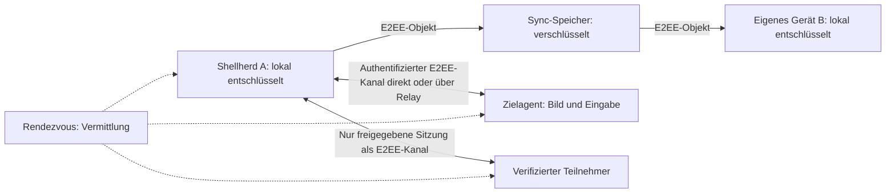

# Block 0: Bedrohungsmodell und Sicherheitsabnahme

Stand: 2026-11-10 (H5). Arbeitsentwurf; Anforderungen, keine bereits implementierten Garantien. Der aktuelle Umsetzungsstand steht in den Abschnitten „Stand der Befunde“ bis „Stand H5“; die Sicherheitsregeln und Abnahmetests weiter unten sind Anforderungen, keine Zusagen.
Übergeordneter [Arbeitsplan](selfhosted-e2ee.md).

Ergänzung aus Block 1: [Protokoll- und Offline-Sync-Entwurf](selfhosted-protocol.md). Die lokale Datei bleibt offline führend; Clients konsolidieren konkurrierende Änderungen nach Wiederverbindung. Prototypbeschränkungen zu Recovery, Verwaltungsautorität und Publikationsfreigaben stehen im Block-1-Entwurf.

## Stand der Befunde aus dem Review vom 2026-11-09

Härtung H1 setzt diese Befunde um (Spec `docs/superpowers/specs/2026-11-09-security-hardening-design.md`). Das ist keine Sicherheitsfreigabe und ersetzt keinen unabhängigen Review.

| Befund | Gegenstand | Stand |
| --- | --- | --- |
| M1 | Rate-Limits | Behoben im Server: Limits pro Quelle (`SHELLHERD_SERVER_TRUSTED_PROXY=1` hinter dem Proxy), Backoff bei Anmeldefehlern, Verbindungslimit je Adresse direkt am Port. Seit H3.1 nimmt `SHELLHERD_SERVER_TRUSTED_PROXY` eine Adresse oder CIDR-Liste statt `1` (siehe „Stand H3.1“). Gegen verteilte Floods hilft nur ein privates Netz (WireGuard/Tailscale, H2). |
| M2 | Fingerabdruck-Vergleich per Checkbox | Behoben: getippte Prüfung beidseitig (seit H2 16 Hex-Zeichen = 64 Bit, vorher 12), Pinning geprüfter Geräte, genau ein DTLS-Fingerabdruck. 2^64 Schlüsselerzeugungen gegen einen rechenstarken Betreiber sind teuer, aber kein Beweis; zusätzlich bestätigt der Noise-Handshake den Schlüssel gegen den vollen Fingerabdruck (256 Bit). H1-Pins (48 Bit) bleiben gültig. Die Prüfung schützt gegen einen bösartigen Server bei ehrlichem Renderer, nicht gegen einen kompromittierten Renderer. |
| M3 | Serverpasswort gleich Vault-Passwort | Behoben (H1), seit H3 für den Normalbetrieb geschlossen: Das Passwort geht nur noch bei der Einschreibung eines Geräts über die Leitung (einmal je Gerät), danach nie wieder; die Anmeldung prüft per Argon2id, dass beide verschieden sind, bevor etwas gesendet wird. Die Importprüfung greift nur, wenn in derselben Verbindung mit Passwort eingeschrieben wurde (nach einer passwortlosen Sitzung gibt es keinen Digest). |
| M4 | Aufnahme ohne native Zustimmung, keine Permission-Handler, keine CSP, Tracks nicht erzwingbar beendbar | Behoben: Permission- und Display-Media-Handler im Main geben eine Bildschirmquelle nur nach Zustimmung im nativen Dialog für die aktuelle Sitzung frei (auch `getUserMedia` mit Desktop-Quelle läuft über denselben Dialog; Desktop-Audio bleibt gesperrt). Restrisiko: Ein kompromittierter Renderer kann den Dialog auslösen, aber nicht bestätigen; Permission-Handler deny-by-default, CSP, Notbremse per Fensterneuladen nach 2 s. Wayland-Portal und Windows-Capture sind nicht manuell geprüft. H2: Nur der `media`-Check ist verschärft (nur `video`); die Anfrage-Regel bleibt, weil `getDisplayMedia` und Legacy-Desktop-`getUserMedia` in Electron 44 im Handler nicht unterscheidbar sind. Der Legacy-Desktop-Pfad nach erteilter Zustimmung (andere Quelle, Desktop-Audio) bleibt Restrisiko (M4-Rest); es bleiben Zustimmung je Sitzung, nur Hauptframe, CSP und Notbremse. **Seit H5 neu gefasst:** Aufnahme und Verbindung laufen in einem eigenen Medienfenster; die Notbremse (Fensterneuladen) entfällt, Beenden zerstört das Fenster samt Prozess. M4-Rest gilt für das Agentenfenster als geschlossen (siehe „Stand H5“). |
| N1 | Fremdes Objekt blockiert den Sync | Behoben: übersprungen und gezählt; Client-Limits 100/32 MiB wie der Server. Seit H2 entfernt „Fremde Objekte entfernen“ nur nicht lesbare Objekte (AEAD-Öffnung unter dem Vault-Schlüssel), sonst belegen sie weiter das Kontingent. |
| N2 | Registrierung ohne Besitznachweis | Behoben: Challenge mit statisch-ephemerem X25519-DH bei jeder Registrierung. |
| N3 | Kanal ohne Forward Secrecy (statisch-statisches DH) | Behoben (H2): Noise XX mit ephemeren Schlüsseln, Prologue mit Server-ID, Sitzung, Nonce, Zweck und Rollen; der Schlüssel der Gegenseite kommt aus dem Handshake, nicht vom Server. Kein Downgrade: ein Server ohne `rendezvousNoise` wird abgelehnt. |
| N4 | Schwache Passwörter, Aussperren des Besitzers | Behoben: Init schlägt generiertes Passwort vor, eigene Passwörter mindestens 16 Zeichen; Backoff je Quelle; seit H3.1 zusätzlich eine globale Passwortsperre (siehe „Stand H3.1“); konstantzeitiger Namensvergleich. Eigene Passwörter verlangen seit H3.1 mindestens 20 Zeichen; Altkonten behalten ihr Passwort, der Server warnt beim Start. |
| N5 | Pins im Klartext | Behoben: Identitätsdatei v2 mit MAC. Rollback auf eine ältere gültige Datei bringt alte Pins zurück, eine v1-Datei stuft alle Pins auf ungeprüft zurück. |
| N6 | Image ohne Digest | Behoben: Basisimage per Digest (Tag und Datum im Dockerfile). Der Digest wird manuell erneuert (README, „Image aktualisieren“). |
| N7 | Consent-Spam | Behoben: 10 min Stummschaltung am Agent, eine offene Anfrage je Paar und 30 s Sperre nach Ablehnen am Server. |
| I4 | Rollenbindung im Kanal | Behoben (folgenlos). |
| I5 | Caddy `1MB` | Behoben: `1MiB`. |

## Stand H2 (Sicherer Kanal)

Härtung H2 (Spec `docs/superpowers/specs/2026-11-09-secure-channel-design.md`, Validierungs-Anhang geht vor). Keine Sicherheitsfreigabe, kein unabhängiger Review.

| Gegenstand | Stand |
| --- | --- |
| N3 Forward Secrecy | Behoben: Noise XX, ephemere Schlüssel je Sitzung (siehe Tabelle oben). |
| M2 Prüflänge | 16 Zeichen, plus Schlüsselbestätigung im Handshake. |
| Privates Netz | Option für HTTP zu WireGuard-/Tailscale-Adressen (10/8, 172.16/12, 192.168/16, 100.64/10, `fc00::/7`). Im fremden WLAN lägen Serverpasswort, Token und Chiffrat im Klartext; der Hinweistext sagt das. Ein kompromittierter Renderer kann `privateNetwork: true` ohne Klick senden, das gleicht der freien URL-Wahl und wird angenommen. Gegen verteilte Floods hilft das private Netz. 100.64/10 ist nur wegen Tailscale erlaubt: Bei Provider-CGNAT liegen fremde Kunden im selben Bereich und könnten mitlesen (R-H31-8, siehe „Stand H3.1“). |
| Kompaktierung | Aufbewahrung der jüngsten 16 Versionen, kumulative `compacts`-Liste (höchstens 256), Löschen per `DELETE`. `history` erkennt das Löschen bereits bestätigter Objekte. |
| Löschrecht per Konto | Grenze: Jede Anmeldung des Kontos (Token, 15 min) darf Objekte löschen. Das betrifft die Verfügbarkeit. Löschen oder Zurückhalten noch nie gesehener Objekte bleibt unerkennbar (Freeze; auch nach H3 unverändert, siehe I3). |
| M4-Rest | Legacy-Desktop-`getUserMedia` nach erteilter Zustimmung bleibt offen (E1). **Seit H5:** für das Agentenfenster geschlossen (E3), siehe „Stand H5“. |
| Native Addon | `sodium-native` ist nur unter Linux x64 ausgeführt; fehlt es, ist der Fernzugriff nicht verfügbar. |
| Bibliotheks-Interna | Das Löschen von Schlüsselmaterial in `dispose` nutzt Felder von `noise-handshake` 4.2.0 (exakt gepinnt). Restbytes der HKDF-Ausgabe und JS-Strings bleiben bis zur GC im Speicher. |
| H1-Server | Ein Server ohne `DELETE` lässt das Konto mit H2-Clients bis 507 wachsen. Server und Clients gemeinsam aktualisieren. |

## Stand H3 (Gerätesignaturen und zufälliger Sync-Schlüssel)

Härtung H3 (Spec `docs/superpowers/specs/2026-11-09-device-keys-design.md`, Validierungs-Anhang `…-validation.md` geht vor). Keine Sicherheitsfreigabe, kein unabhängiger Review.

| Gegenstand | Stand |
| --- | --- |
| M3 Passwort auf der Leitung | Geschlossen für den Normalbetrieb: Das Serverpasswort dient nur der Einschreibung (`POST /v1/devices`, einmal je Gerät). `POST /v1/login` gibt es nicht mehr, Sitzungen entstehen aus einer signierten Challenge (`/v1/challenge`, `/v1/session`). |
| I1 Offline-Raten des Vault-Passworts aus dem Serverbackup | Behoben: Serverobjekte tragen kein Vault-KDF mehr. Sie sind unter einem zufälligen 256-Bit-Sync-Schlüssel verschlüsselt, der in einer Keybox unter einem 128-Bit-Wiederherstellungscode liegt. Raten ist unabhängig vom Vault-Passwort aussichtslos. |
| I2 Vault-Schlüssel als Objektschlüssel | Behoben: Der Vault-Schlüssel verschlüsselt keine Serverobjekte mehr. Lokal leitet HKDF weiter den Schlüssel des Sync-Zustands ab (getrennter Zweck). |
| I3 Zurückhalten nie gesehener Objekte | Unverändert, mit Begründung: Ein konsistenter Schnitt (Server zeigt allen Geräten denselben älteren Stand) ist ohne zweiten Kanal nicht von „war offline“ zu unterscheiden. Vektoruhren, Anker oder signierte Tombstones ändern das nicht, weil der Server ältere Anker konsistent zeigen kann. Autorenstempel ordnen Versionen und Kompaktierungen Geräten zu, erkennen den Schnitt aber nicht. |
| Geräte-Roster | Der Server hält je Gerät Signatur- und Noise-Schlüssel (`devices.json`, höchstens 16 aktive und 64 Einträge). Widerruf ist signiert, beendet Sitzungen und Rendezvous-Präsenz sofort und `authorize` prüft das Roster bei jedem Request. Das Rendezvous bindet das registrierte Gerät an den eingeschriebenen Noise-Schlüssel. |
| Temporäre Identität | Ohne Schlüsselablage des Betriebssystems schreibt sich das Gerät nur im RAM des Servers ein (höchstens 8, Ablauf nach 12 h, weg beim Neustart). Kein Klartext-Fallback. |
| Autorenstempel und Quarantäne | Versionen tragen eine Ed25519-Signatur des Geräts. Versionen eines widerrufenen Geräts ab dem Widerruf werden nicht automatisch übernommen, mit Schutz für Vorfahren und bereits bestätigte Versionen. Unbekannte Autoren bleiben gültig und werden gezählt. |

**Neue und bleibende Grenzen (H3):**

- Wer das Serverpasswort kennt, kann Geräte einschreiben, alle anderen widerrufen und Objekte löschen. Klartext liest er ohne Wiederherstellungscode nicht. Ausweg: `rotate-password` und Wiedereinschreibung der eigenen Geräte. Ein Passwortwechsel widerruft keine Geräte.
- Eine bestehende WebRTC-Verbindung läuft nach einem Widerruf weiter, weil sie direkt zwischen den Geräten besteht (höchstens bis zum Ende der Sitzung nach fünf Minuten). Die Fernzugriff-Token bleiben 15 Minuten Inhaberausweise; der Widerruf wirkt, weil `authorize` das Roster prüft.
- Die Einschreibung beweist nur den Besitz des Signaturschlüssels, nicht den des X25519-Schlüssels. Ein Passwortbesitzer kann eine fremde, noch nicht eingeschriebene ID belegen (sichtbar im Roster, 409 für das echte Gerät). Die Rendezvous-Präsenz prüft den Besitz weiter.
- Ein Passwortbesitzer kann bis zu 8 Keyboxen mit kleinerer ID einstellen. Der Client probiert nur die ersten 8 nach ID und findet die echte dann nicht (nur Verfügbarkeit; der Passwortbesitzer kann ohnehin löschen). *Seit H4 behoben:* Der Client probiert alle Keyboxen der Zielepoche (höchstens 100, das Kontolimit), die Obergrenze 8 entfällt.
- Die Quarantäne gilt für entfernte dauerhafte Geräte. Entfernte temporäre Geräte verlassen das Roster, ihre Versionen werden angenommen und als „unbekannter Autor“ gezählt. Hochladen können sie nach dem Entfernen nicht mehr, weil ihre Sitzung gelöscht ist.
- Ein Gerät mit Sync-Schlüssel kann die Quarantäne umgehen, indem es einen unbekannten Autor einträgt. Sie hält nur ehrliche, veraltete oder später zurückgespielte Versionen eines widerrufenen Geräts auf. Der Stempel trägt die Uhr des Autors: Abweichungen führen höchstens zum Zurückhalten, nie zur Sperre.
- Ein widerrufenes Gerät behält den Sync-Schlüssel und seine lokalen Daten. *Seit H4:* Der Schlüssel lässt sich per „Sync-Schlüssel erneuern“ rotieren (Epoche); die App empfiehlt das nach jedem Entfernen. Das Gerät liest dann nichts Neues mehr, die alten Daten behält es (T04-Grenze „neue Daten“).
- Ein Wechsel der Server-URL verlangt eine neue Einschreibung (Hinweis „angemeldet unter …“): Der Client pinnt die URL je Einschreibung.
- Schwache Ed25519-Schlüssel: Nur der Identitätspunkt wird abgewiesen; andere Punkte kleiner Ordnung kann nur ein Einschreibender mit Passwort setzen, der damit nichts gewinnt, was er nicht ohnehin hat.
- Die Migration mehrerer Geräte ohne vorherigen gemeinsamen Stand ergibt zwei Wurzeln ohne Basis, also einen Konflikt ohne Auflösungsweg. Reihenfolge: vorher alle Geräte abgleichen, das erste neu abgleichen, die weiteren neu laden.
- Sync-Schlüssel, Code und Passwort liegen als JS-Strings bis zur Garbage Collection im Speicher.
- Der Wiederherstellungscode erscheint genau einmal im Renderer; ein kompromittierter Renderer kann ihn lesen (wie das Vault-Passwort bei der Eingabe).

## Stand H3.1 (ganzheitliche Härtung)

Härtung H3.1 (Spec `docs/superpowers/specs/2026-11-10-holistic-hardening-design.md`, Validierungs-Anhang `…-validation.md` geht vor) setzt die Befunde eines ganzheitlichen Reviews um. Lab-Bruch wie bei H3: Das Nachweisformat ändert sich, es gibt keinen Kompatibilitätspfad. Keine Sicherheitsfreigabe, kein unabhängiger Review.

| Befund | Gegenstand | Stand |
| --- | --- | --- |
| C1 | Nachweis gilt für jeden Server mit gleicher `serverId` | Behoben: Einschreibung, Sitzung und Widerruf binden die vom Server konfigurierte Origin (`SHELLHERD_SERVER_ORIGIN`, nie der Host-Header) und tragen neue Domänen-Tags (`-v2`, Anfrage `-v3`). Ein Nachweis für Server A wird bei Server B mit 401 abgelehnt. `/v1/info.origin` lässt den Client eine falsch konfigurierte Origin sofort melden. Der App-Pin ist über `(serverId, Origin)` geschlüsselt; bei anderer Adresse verlangt die Einschreibung eine ausdrückliche Bestätigung (Sync und Fernzugriff). Das ist zusätzlicher Schutz, die Absicherung leistet der Server. |
| S1 | Wenige langsame, unauthentifizierte Requests blockieren den Server | Behoben im Rahmen des Prototyps: höchstens 256 Verbindungen, Header-Frist 5 s, Lesefrist 3 s für Bodies vor der Anmeldung, höchstens 4 gleichzeitige Anfragen je Quelle. Das Verbindungslimit je Adresse greift nur direkt am Port; hinter dem Proxy ersetzt die Nebenläufigkeit je Quelle es. Gegen verteilte Floods hilft weiter nur ein privates Netz. |
| S2 | Challenge-Flut füllte den Speicher | Behoben: Challenges sind zustandslos (HMAC mit einem Schlüssel nur im RAM, 30 s). Verbrauchte Nonces kommen bis zum Ablauf in eine begrenzte Menge (4096); ist sie voll, antwortet der Server mit 429, statt eine zu verdrängen. |
| S3 | `TRUSTED_PROXY=1` ließ jeden `X-Forwarded-For` zu | Behoben: `SHELLHERD_SERVER_TRUSTED_PROXY` nimmt eine Adresse oder CIDR-Liste; der Header zählt nur, wenn die Socket-Adresse darin liegt. Der alte Wert `1` ist ein Startfehler. Compose legt ein festes Projektnetz an. Voraussetzung: Docker Engine ab 28 (sonst erreichen LAN-Nachbarn den Container-Port per Routing). Lokale Prozesse auf dem Homeserver erreichen `127.0.0.1:8787` und dürfen XFF setzen. **Seit H4 behoben für den Socket-Betrieb:** `SHELLHERD_SERVER_SOCKET` (Unix-Socket, Modus 0660, Override `compose.socket.yaml`) hat keinen TCP-Port mehr, XFF kommt dann immer vom Proxy (siehe „Stand H4“). Der Standard bleibt TCP auf `127.0.0.1`. |
| S4 | Passwortraten nur durch den scrypt-Durchsatz begrenzt | Behoben: harte globale Passwortsperre (höchstens 20 echte Fehlvergleiche je 10 min, danach 429 für alle bis zum Fensterende, nur im RAM) und Passwörter ab 20 Zeichen bei `account-init`. **Der Besitzer kann ausgesperrt werden**: Wer 20 Requests je 10 Minuten schickt, hindert ihn an Neueinschreibungen. Eingeschriebene Geräte sind nicht betroffen, ein Neustart des Servers hebt die Sperre auf. Fehlerhafte Requests zählen nicht, nur echte Fehlvergleiche. **Seit H4 geschlossen bei `invite-only`** (`lock-enrollment`): Die Passwortform endet mit 403 vor der Passwortprüfung, es gibt keinen online ratbaren Wert und keine Sperre mehr, die man auslösen könnte. Ohne den Schalter bleibt es bei der Grenze oben. |
| S5 | Kein Weg, Geräte bei laufendem Leck zu entfernen | Behoben: Offline-Befehle `list-devices` und `revoke-device <id>` (nur bei gestopptem Server) und ein dokumentierter Ablauf nach einem Passwortleck (Server-README). |
| S10 | Generiertes Passwort im Container-Log | Behoben: Es liegt einmalig in `initial-password.txt` (0600) und wird nach der ersten Einschreibung gelöscht. |
| C2/A1 | Neuer Wiederherstellungscode erzeugt nur Scheinschutz | H3.1 (R-H31-7): ehrlich begrenzt, weil der Code nur denselben Sync-Schlüssel neu verpackte. **Seit H4 behoben:** `regenerateRecoveryCode` entfällt, „Sync-Schlüssel erneuern“ erzeugt einen neuen Schlüssel in einer neuen Epoche (siehe „Stand H4“). Alte Serverkopien samt altem Code lesen nur noch die **alten** Daten. |
| C3/C4/R3 | Abgebrochene oder konkurrierende Einrichtung hinterließ Schlüsselreste | Behoben: Der Abbruch nimmt eigene Keybox und eigene Versionen zurück (best effort) und löscht den Checkpoint; die alte Keybox wird vor der neuen entfernt. Restrisiko: Beendet der Host die Verbindung zwischen dem Ausstellen des Codes und der Antwort, geht der Code verloren; Ausweg ist seit H4 eine erneute „Sync-Schlüssel erneuern“ (eine zweiphasige Code-Übergabe kommt nicht, siehe „Stand H4“). |
| C8 | Sync-Zustand eines anderen Servers wurde als falsches Passwort gemeldet | Behoben: Der Zustand trägt die Server-ID im Klartext-Rahmen (v3) und führt bei Abweichung zur eigenen Meldung, ohne etwas zu ändern. |
| C9 | `compacts` zurückgehaltener Versionen entschuldigten fehlende Versionen | Behoben: Sie entschuldigen nichts mehr. (Vorher konnte ein Server so bestätigte Versionen aus der Liste nehmen, ohne dass `history` anschlug; die Wirkung war auf Verfügbarkeit begrenzt.) |
| C11 | Regel „Server darf Widerruf nicht rückgängig machen“ stand ohne Vorbehalt | Als „noch nicht erfüllt“ markiert (siehe „Koppeln“). |
| C12 | 100.64/10 in der Ausnahme für privates HTTP | Bleibt erlaubt, weil Tailscale diesen Bereich nutzt (R-H31-8). Bei Provider-CGNAT teilt man den Bereich mit fremden Kunden; dann nicht verwenden, Token und Einschreibungspasswort gingen im Klartext durch fremde Netze. |
| A3/A7/A8 | Handbuch ohne Flag, Entwicklungsstatus und Prüfeinschränkung | Dokumentiert (Handbuch). |
| A6 | Electron-Fuses | Teilweise: `RunAsNode` aus (nur Linux) und `EnableNodeOptionsEnvironmentVariable` aus (Linux und Windows), gesetzt im afterPack-Hook. `EnableNodeCliInspectArguments` und die asar-Fuses folgen nach einem Windows-Signaturtest (H4): Das signierte Binary bleibt bis dahin über `--inspect` debugbar. |

**Neue und bleibende Grenzen (H3.1):**

- **Upgrade (Lab-Bruch):** Alle Geräte schreiben sich neu ein. Eine `devices.json` der Vorstufe (`version: 1`) führt zu einem Startfehler mit Hinweis (Datei wegschieben). Alte `.sync-state`-Dateien (v2) bleiben lesbar; gehört ein Zustand zu einem anderen Server, hilft das Löschen der Datei.
- **Namensregel:** Gerätenamen folgen einer festen Regel (Buchstaben, Ziffern, Leerzeichen und `-_.,()'`, 1–64 Zeichen, keine Steuer- oder Formatzeichen, keine Folge von 8 oder mehr Hex-Zeichen, auch nicht durch Trennzeichen oder Lookalikes getrennt). So kann niemand einen Prüfcode im Namen fälschen. Die Homoglyphentabelle ist bewusst klein: Lateinische Lookalikes (`O`/`0`, `l`/`1`) und nicht-hex Trenn-Buchstaben bleiben möglich. Gegenmittel sind der Hinweis im Prüfdialog (nie aus einem Gerätenamen ablesen) und der Fingerabdruck am anderen Gerät.
- **Fremde Versionen:** Das Entfernen von Versionen mit anderem Sync-Schlüssel erfolgt nur per ausdrücklichem Opt-in mit Warnung.
- **Prüfung vor dem Senden:** Die Prüfung, dass Serverpasswort und Vault-Passwort verschieden sind, läuft nur bei entsperrtem Vault. Bei gesperrtem Vault gibt es keinen Vergleich, und die Einschreibung wird nicht blockiert.
- **Roster vom Server:** Siehe „Koppeln“. Ein bösartiger Server kann einen Widerruf für die Quarantäne verschweigen.
- **Entwicklungsstand:** Sync- und Fernzugriff-Lab laufen nur ungepackt mit `SHELLHERD_SYNC_LAB=1` bzw. `SHELLHERD_REMOTE_LAB=1`, der Abgleich nur unter Linux. Das gepackte Paket schaltet beide Labs aus (Smoke-Prüfung); seit H4 enthalten Release-Bundles den Lab-Code gar nicht mehr (siehe „Stand H4“).

## Stand H4 (Schlüsselepochen, Anmeldecodes, Roster-TOFU)

Härtung H4 (Spec `docs/superpowers/specs/2026-11-10-key-epochs-design.md`, Validierungs-Anhang `…-validation.md` geht vor). Leitsatz: **Niemand liest Neues mit, niemand kommt ohne eingeschriebenes Gerät hinein.** Nur Node-`crypto` (HKDF-SHA256, AES-256-GCM, Ed25519, `randomBytes`), keine neue Kryptografie-Bibliothek. Lab-Bruch wie bei H3 und H3.1 (Hülle v2, Keybox v2, Autorenstempel v2, Nachweis v4, Checkpoint v3, Identitätsdatei v4); Geräte schreiben sich **nicht** neu ein. Keine Sicherheitsfreigabe, kein unabhängiger Review.

| Gegenstand | Stand |
| --- | --- |
| C2/T04 Schlüsselepochen | **Für neue Daten behoben:** Jede Rotation („Sync-Schlüssel erneuern“) legt einen neuen zufälligen `K_sync` in der Epoche `e + 1` an. Der Server sieht die Epochenzahl in der Hülle, mehr nicht. Entfernte Geräte, ein alter Code und eine alte Serverkopie lesen danach nichts Neues mehr. Bestehende Geräte übernehmen die neue Epoche nur durch Eintippen des neuen Wiederherstellungscodes (keine Schlüsselverteilung über X25519). Die Übernahme verliert keine lokalen Änderungen: Der Merge läuft von einer gemeinsamen Basis (`adopts`-Liste in jeder Keybox), ein Widerspruch wird ein normaler Konflikt. |
| Anmeldecode | Ein einladendes Gerät erzeugt 16 Zufallsbytes. HKDF liefert daraus das `enrollSecret` (an die Origin gebunden, nur dieses sieht der Server, als SHA-256 im RAM, zehn Minuten, einmal) und den Schlüssel einer Einladungs-Keybox mit dem aktuellen Sync-Schlüssel. Ein Code ersetzt Passwort **und** Wiederherstellungscode für das neue Gerät. Widerruft man den Aussteller, verfallen seine offenen Einladungen samt Keybox. |
| S4 / Besitzer-Aussperrung | Mit `lock-enrollment` (`invite-only`) geschlossen, siehe S4 oben. Die Passwortform wird mit 403 vor scrypt abgelehnt. |
| Roster-TOFU (Sync-Lab) | Die Identitätsdatei v4 pinnt je Einschreibung die Geräteliste (höchstens 64 Pins, vom MAC gedeckt). Ein neues, nicht selbst eingeladenes Gerät erscheint als Hinweis „Neues Gerät“ mit „Zur Kenntnis genommen“. Ein bekanntes Gerät mit anderem Signaturschlüssel ergibt den Fehler `syncRoster` ohne Abgleich. Pins widerrufener Geräte bleiben, auch wenn der Server den Eintrag weglässt; bei Widerspruch gilt der frühere Widerruf. Eine Wiederbelebung wirkt erst nach der Bestätigung. |
| Nachweis v4 | `shellherd-device-request-v4` bindet den SHA-256 des Bodys; nötig für den signierten `POST /v1/invites`, gilt auch für `DELETE /v1/devices/<id>` (leerer Body). |
| S3-Rest Unix-Socket | `SHELLHERD_SERVER_SOCKET` statt TCP-Port. XFF setzen kann dann nur, wer auf den Socket zugreifen darf (Gruppe des Proxys, root). Der Standard-Betrieb bleibt TCP auf `127.0.0.1`. |
| Lab-Code in Release-Bundles | Die Build-Konstante `__SHELLHERD_LABS__` (Release-Builds mit `SHELLHERD_RELEASE=1`) entfernt Sync- und Fernzugriff-Lab samt IPC aus `dist*`. Der Smoke prüft das in allen Chunks. Das setzt voraus, dass Rollup tote Zweige entfernt. Läuft `npm run dist*`, enthält `out/` keine Labs mehr: die Szenen brechen dann mit Exit 2 ab. |

**Neue und bleibende Grenzen (H4):**

- **Zurückhalten der neuen Epoche:** Ein bösartiger Server kann einem Gerät, das die neue Epoche noch nicht übernommen hat, sie dauerhaft vorenthalten. Das Gerät schreibt dann unter dem alten Schlüssel weiter, und den lesen entfernte Geräte und alte Codes. T04 gilt nur für Geräte, die übernommen haben. Ein Zurückdrehen nach der Übernahme fällt auf (`acked` fehlt, `syncHistory`; kleinere Epochen werden ignoriert und gelöscht).
- **Alte Serverkopie:** Alte Kopien samt altem Code lesen die alten Daten weiter. Ein nicht entferntes, aber heimlich kompromittiertes Gerät liest weiter mit. Die Rotation ist kein Schutz für bereits Gelesenes.
- **Fälschung einer höheren Epoche:** Ohne Code blockiert sie nur den Abgleich (`syncRotated`, dann `syncRecoveryCode`). Mit einem geleakten alten Code lässt sich für jede Epoche eine passende Keybox bauen. Deshalb übernimmt ein Gerät mit Geräteidentität eine neue Epoche nur, wenn eine lesbare Version der Epoche einen gültigen Autorenstempel (v2, bindet die Epoche) eines bekannten, nicht widerrufenen und vom Nutzer bestätigten Geräts trägt. Ein Gerät mit offenem Hinweis „Neues Gerät“ zählt nicht, weil der Server Einträge beliebig hinzufügen kann. Der Rotierende selbst muss nicht mehr aktiv sein, jedes bestätigte Gerät, das in der Epoche geschrieben hat, genügt. Sonst endet der Lauf mit `foreignKey`, ohne etwas zu schreiben. Ohne Geräteidentität (Altpfade, Tests) gibt es keine Prüfung. Grenzen: Ein frisch angemeldetes Gerät übernimmt die erste Geräteliste ungeprüft vom Server, dort schützt die Prüfung nur gegen Geräte, die erst später auftauchen. Haben alle bestätigten Autoren der Epoche ihre Stempel durch Verdichtung verloren oder sind entfernt, kann ein lange offline gewesenes Gerät die Epoche nicht übernehmen (`foreignKey`, Ausweg: per Anmeldecode neu anmelden). Das Aufräumen löscht nur IDs von Hüllen mit geprüftem Hash und kleinerer Epoche; mehr als mit eigenem `DELETE` erreicht der Server nicht.
- **Verlorener Code:** Wird der Host zwischen dem Abschluss der Rotation und der Antwort `stale`, ist der neue Code verloren. Ausweg: erneut „Sync-Schlüssel erneuern“. Eine zweiphasige Code-Übergabe kommt nicht (E14). Ein Abbruch während des Aufräumens der alten Epoche lässt den Marker stehen, der nächste Abgleich zeigt einen frischen Code.
- **Rennen nach Absturz:** Eine unterbrochene und eine gleichzeitige fremde Rotation können im Wiederholungspfad den Checkpoint verwerfen. Das Gerät braucht dann den Code des Gewinners; der lokale Vault bleibt erhalten.
- **Adoption ohne eindeutige Basis:** Gibt es keine eindeutige gemeinsame Basis oder mehrere Köpfe in der neuen Epoche, meldet das Gerät `syncConflict` ohne zu schreiben. Ausweg manuell (`.sync-state` löschen und neu laden; ungesyncte Änderungen von Hand nachtragen).
- **Abgefangener Anmeldecode:** Wer ihn binnen zehn Minuten abfängt, erhält Einschreibung und aktuellen Schlüssel (sichtbar über `enrolledBy` und die Geräteliste). Ausweg: Entfernen und Rotation. Ein mit deinem eigenen Anmeldecode angemeldetes Gerät wird als Info gemeldet („angemeldet mit deinem Anmeldecode“), nicht als Warnung; löst ein Angreifer den Code vor deinem Gerät ein, fällt er also nur über diese Info und die Geräteliste auf.
- **Einladungsreste:** Nach einem Serverneustart bleiben Einladungs-Keyboxen liegen, bis der Aussteller abgleicht (20 Minuten) oder rotiert.
- **Fehlermeldung bei altem Code:** Ein frisches Gerät mit altem Code sieht nach abgeschlossenem Aufräumen `syncRecoveryCode` statt `syncRotated`.
- **Roster-TOFU:** Der erste Lauf vertraut der Liste. Temporäre Identitäten (Szenen, CI, Systeme ohne Schlüsselablage) halten Pins nur im RAM. Eigene Einladungen erscheinen nach einem Neustart einmal als „Neues Gerät“. Nach einem Serverreset mit neuem Roster meldet der Client alle Geräte als neu, bei gleichem Gerät mit anderem Schlüssel `syncRoster`; Ausweg: Einschreibung vergessen und neu einschreiben. Das Remote-Lab lädt kein Konto-Roster und pinnt nur Rendezvous-Präsenz.
- **Metadaten:** Der Server sieht die Epochenzahl und die Anzahl der Einladungen.
- **Unix-Socket:** Der Socket-Betrieb ignoriert `PORT`, `HOST` und `TRUSTED_PROXY` bis auf eine Hinweiszeile.
- **Kein Zwang zu `invite-only`:** Der Schalter ist Betreiberentscheidung (Offline-Befehl); das Server-README empfiehlt ihn direkt nach dem ersten Gerät. Bootstrap und der Verlust aller Geräte brauchen den Passwortweg (`unlock-enrollment`).
- **Keine automatische Rotation beim Entfernen:** Sie ist ein eigener Klick mit Rückfrage und verlangt einen sauberen, vollständig abgeglichenen Stand (sonst `syncRotateBlocked`). Nach jedem Entfernen eines fremden Geräts, auch eines temporären, empfiehlt die App sie.
- **CI-Szene:** Die Sync-Szene läuft im Linux-Job unter `xvfb-run`; sie kann flaky sein und fliegt dann aus der CI (die Szene bleibt manuell).
- **Nicht in H4:** TOTP (endgültig nein), Per-Gerät-Keybox über X25519, Fernansicht-Isolation (V5, V6, V8) und gemeinsamer `DeviceSessionClient` (A11) gehören nach H5; die restlichen Fuses brauchen den Windows-Signaturtest.

## Stand H5 (Isolation der Fernansicht)

Härtung H5 (Spec `docs/superpowers/specs/2026-11-10-remote-isolation-design.md`, Validierungs-Anhang `…-validation.md` geht vor). Leitsatz: **Das privilegierte Hauptfenster verarbeitet keine Daten der Gegenseite und nimmt nichts auf.**

| Gegenstand | Stand |
| --- | --- |
| V5 Fensterisolation | **Behoben:** Aufnahme (Agent), Bildanzeige (Viewer) und die WebRTC-Verbindung laufen in einem eigenen Medienfenster mit eigener Partition, `sandbox`, ohne `desktopApi`, mit eigenem Preload (`remote-media.cjs`) und eigener CSP. Das Hauptfenster zeigt nur Zustimmung und Status. Das Fenster endet mit der Sitzung, mit der Sperre des Vaults und mit dem Hauptfenster; Beenden zerstört es samt Renderer-Prozess. Pro Prozess lebt höchstens ein Medienfenster. |
| V6 Fensterschutz unter Windows | **Implementiert, Laufzeit ungeprüft:** Unter Windows nimmt Shellherd seine Fenster und RDP-Flächen aus dem übertragenen Bild aus; der Schutz fällt erst, wenn alle Agentenfenster wirklich beendet sind (fail-closed). Es gibt keinen Test auf einem echten Windows-Rechner; ein Rezept steht im Handbuch („Manuell prüfen (Windows)“). Vor Windows 10 2004 gibt es nur `WDA_MONITOR` (schwarze Fläche), der Child-Modus verlässt sich auf die Affinität des Electron-Fensters. |
| V8 Doppelklick | **Behoben:** Der Knopf `Bildschirm freigeben` ist nach dem Klick gesperrt (`armed`), der Systemdialog erscheint frühestens nach 550 ms. Die Szene prüft beides (Sperre sichtbar, Zeitstempel im Recorder). |
| M4-Rest | **Für das Agentenfenster geschlossen (E3):** Nach `hello` mit leerem `peerName` hat das Medienfenster vor der Aufnahme keine Daten der Gegenseite im Agentenfenster verarbeitet (das Angebot entsteht erst nach der Zustimmung, die Antwort folgt später). Danach ist der einmalige Grant verbraucht, weitere Anforderungen sind abgelehnt. |
| B1 Absender-IPC | **Als Fund behoben:** Das Medienfenster hätte fast die gesamte Vault-, SSH-, Kube-, RDP- und Zwischenablage-IPC erreicht, und `closeOwnerSessions` hätte seine Sitzungen nie aufgeräumt. Privilegierte IPC nimmt jetzt nur Absender aus der Fensterregistry an. |
| B2 Preload | Beide Preloads sind eigenständig (keine Chunks, kein `require("./`); die Szene prüft das vor dem Lauf. |

**Restrisiken (H5):**

- **GPU- und Netzwerkprozess:** V5 isoliert den Renderer. Videodekodierung kann je nach Hardware im GPU-Prozess laufen, den das Hauptfenster teilt; ein Decoder-Fehler dort ist nicht isoliert.
- **Eigenes WebRTC:** Ein kompromittiertes Medienfenster kann eine eigene `RTCPeerConnection` zu einer beliebigen Adresse öffnen (die CSP greift dort nicht, es gibt keinen Netzfilter für die Medien-Session). Es hat dabei nur das Bild, das es ohnehin sieht oder sendet, und keinen Vault-Zugriff.
- **Pfad B:** Die Quellen-ID wählt die Seite. Sie ist zu diesem Zeitpunkt nicht angreifbar (E3), ein Fehler in der eigenen Seitenlogik könnte aber eine andere Quelle wählen.
- **Speicher der Partition:** Wird nur best effort geleert.
- **Sprache und Theme:** Kein Wechsel im offenen Medienfenster.
- **Wayland:** Portal und Laufzeit ungeprüft; `captureMs` (20 s) kann eine langsame Auswahl abbrechen.
- **Frühes Ende:** Endet die Sitzung genau zwischen dem erzwungenen Renderer-Absturz und dem Prozessende, können bereits gepufferte RTP-Pakete noch abgehen (Millisekunden).
- **Nachweis:** `remote-scene.mjs` prüft Pixel (Fake-Capture). Die Szene kann echtes Capture unter X11 prüfen (`SHELLHERD_REMOTE_CAPTURE_FAKE=0`); dieser Lauf steht noch aus. In einer Wayland-Sitzung (auch über XWayland) liefert die Bildschirmaufnahme derzeit kein Bild bzw. hängt; geprüft ist nur der Fake-Modus. Die Szene prüft ferner das Ende bei Beenden und bei Fensterschluss und eine leere CSP-Konsole in allen Fenstern.

**Offen (nicht in H5):**

- Laufzeittest V6 unter Windows.
- A11 (gemeinsamer `DeviceSessionClient`, H6).
- Inspect- und asar-Fuses (brauchen den Windows-Signaturtest).

## Umfang der ersten Ausbaustufe

Aktueller Sync-MVP: Eigene Geräte schreiben sich einmalig mit Server-URL, Benutzername und Serverpasswort ein und weisen sich danach mit ihrem Signaturschlüssel aus; das Vault-Passwort bleibt davon getrennt und ausschließlich lokal. Geräte-Fingerprintvergleich und Verwaltungsgeräte sind für diesen Kontomodus keine Voraussetzung. Der Linux-Entwicklungsprototyp (ungepackt, nur mit `SHELLHERD_SYNC_LAB=1`) bietet manuellen Datei-Sync; eine Produktivfreigabe liegt nicht vor. Die nachfolgenden Regeln für individuelle Geräteidentitäten, Kopplung und Widerruf gelten für die getrennten Geräteprotokoll-Experimente und späteren Fernzugriff. Anschließend folgen beaufsichtigter Fernzugriff und ausgewählte geteilte Sitzungen. Ein Herstellerkonto ist nicht erforderlich. Der lokale Betrieb ohne Server bleibt möglich.

Unbeaufsichtigter Zugriff, Zugriff auf Sperrbildschirm/UAC, Zwischenablage, Dateiübertragung, Aufzeichnung und gemeinsame Vaults mit anderen Personen sind eigene Erweiterungen. Sie erhalten keine implizite Freigabe durch die erste Geräteverknüpfung. Windows und Linux sind Zielplattformen; die genaue Versions-/Desktopmatrix wird vor Block 4 festgelegt.

Recovery-Vorschlag: Ein optionales, lokal erzeugtes Wiederherstellungsgeheimnis, das der Nutzer offline verwahrt. Ohne dieses oder ein verbleibendes berechtigtes Gerät keine Wiederherstellung. Format und Schlüsselhierarchie werden in Block 1 festgelegt. Keine Server-Hintertür.

## Schutzobjekte und Vertrauensgrenzen

| Bereich | Schutzobjekte / Verantwortung | Vertrauen |
| --- | --- | --- |
| Shellherd-Endgerät | Vault-Inhalte, lokale Schlüssel, freigegebene Sitzungen | Betriebssystem und ausführbarer Client müssen vertrauenswürdig sein; Renderer und empfangene Inhalte gelten als mögliche Angriffsflächen |
| Zielagent | Bildaufnahme, Eingabe, lokale Zustimmung, Zugriffsentscheidung | Nur ausdrücklich gekoppelte Geräte; privilegierte Funktionen getrennt vom Netzwerk-/Medienparser |
| Sync-/Rendezvous-Server | Verschlüsselte Objekte, Routing, Quoten | Für Vertraulichkeit, Teilnehmeridentität und Rechteentscheidungen nicht vertrauenswürdig |
| Relay / Proxy / Netzwerk | Weiterleitung und TLS-Terminierung | Sie dürfen die E2EE-Nutzdaten nicht entschlüsseln können |
| Andere Teilnehmer | Nur explizit freigegebene Ansichten und Eingaben | Kein impliziter Zugriff auf Vault, fremde Tabs oder weitere Zielgeräte |
| Image-Registry / Updatequelle | Software und Installationsartefakte | Auslieferung ist keine ausreichende Authentizitätsprüfung; Freigabeprüfung auf Endgerät erforderlich |
| Lokales Backup / Serverbackup | Verschlüsselte Daten und begrenzte Metadaten | Backupbetreiber besitzen keine Entschlüsselungsgeheimnisse |

Ein Angreifer darf Server und Netzwerk vollständig kontrollieren, Antworten verändern, Nachrichten wiederholen, Objekte austauschen, Geräteverzeichnisse fälschen und Verbindungen abbrechen. Er kann eigene Geräte anmelden und gültige, aber eingeschränkte Teilnehmerrechte besitzen. Verfügbarkeit gegenüber einem bösartigen Betreiber wird nicht garantiert.

Ein kompromittiertes berechtigtes Endgerät kann dessen entschlüsselte Daten lesen und erlaubte Aktionen ausführen. E2EE verhindert das nicht. Andere Geräte und nicht freigegebene Vaults müssen durch getrennte Schlüssel und Rechte möglichst abgegrenzt bleiben.

## Datenflüsse

1. **Koppeln:** Das neue Gerät erzeugt seine privaten Schlüssel lokal. Ein bereits berechtigtes Gerät verifiziert den neuen Gegenpart über einen unabhängigen Vergleich oder einen entsprechend abgesicherten Einladungsablauf. Eine vom Server gelieferte Geräte-ID oder ein Anzeigename genügt nicht. Erst nach Bestätigung wird genau der vorgesehene Zugriff eingerichtet.
2. **Sync:** Der Client verschlüsselt Inhalte und bindet deren Kontext, Herkunft und Version kryptografisch an das Objekt. Der Server sieht nur das notwendige äußere Format. Empfangende Geräte prüfen Authentizität, Rechte, Versionsbeziehungen und Größenlimits vor Übernahme. Konflikte bewahren beide Änderungen.
3. **Remote:** Vermittlung stellt Erreichbarkeit her; der Agent authentifiziert den Gegenpart und prüft lokale Rechte. Eine konkrete Sitzung erhält eigene Schlüssel und Zustimmung. Bild und Eingaben laufen E2EE direkt oder über einen Relay. Der Transportweg ändert die Prüfung nicht.
4. **Teilen:** Die Quelle gibt ausschließlich die ausgewählte Sitzung frei. Teilnehmer erhalten eigene, begrenzte Rechte und Sitzungszugriff. Einsehen einer Sitzung kann darin sichtbare Geheimnisse offenlegen. Steuerungsrecht umfasst gegebenenfalls Befehlsausführung mit den Rechten dieser Sitzung.
5. **Entziehen:** Das autorisierende Endgerät beendet die betroffene Sitzung lokal und verwirft deren Berechtigung. Künftige Daten verwenden aktualisierte Schlüssel und Mitgliedschaft. Ein Server darf Widerruf nicht eigenständig rückgängig machen. *Erfüllt mit Grenze (Stand H4, nur Sync-Lab): Der Client pinnt die Geräteliste je Einschreibung (Roster-TOFU). Ein vom Server „vergessener“ oder aufgehobener Widerruf gilt lokal weiter, bis der Nutzer die Wiederbelebung bestätigt; ein bekanntes Gerät mit anderem Signaturschlüssel ist ein harter Fehler. Die Grenze: Der erste Lauf einer Einschreibung vertraut der Liste (TOFU), und erst die Bestätigung hebt einen lokalen Widerruf auf.*

## Sicherheitsregeln mit Prüf-IDs

| ID | Verbindliche Anforderung |
| --- | --- |
| SEC-01 | Keine privaten Endgeräteschlüssel, Vault-Passwörter, Vault-/Sitzungsschlüssel oder Klartext-Nutzdaten beim Server, Proxy, Relay oder in deren Backups |
| SEC-02 | Jedes Pairing bindet verifizierte Geräteidentität, Zweck und Rechte; Änderungen erfordern erneute autorisierte Prüfung |
| SEC-03 | Sync-, Identitäts- und Sitzungsschlüssel sind getrennt; Sitzungsfreigabe gewährt keinen Vault-Zugriff |
| SEC-04 | Manipulierte, kontextfremde, wiederholte oder veraltete Nachrichten werden nach dokumentierten Regeln verworfen; kein stiller Protokoll-Downgrade |
| SEC-05 | Datenänderungen und Konflikte werden authentifiziert; kein stiller Datenverlust oder Ersetzen neuerer bekannter Zustände |
| SEC-06 | Teilnehmer- und Steuerungsrechte werden am autorisierenden Endgerät durchgesetzt; Serverantworten allein erteilen keine Rechte |
| SEC-07 | Stoppen wirkt am Quellgerät sofort: keine weitere Bildfreigabe oder Eingabeannahme für die entzogene Sitzung; Wiederverbindung benötigt neue Autorisierung |
| SEC-08 | Keine Nutzinhalte oder Geheimnisse in Logs, temporären Dateien, Telemetrie, automatischen Crash-Uploads, URLs oder Prozessargumenten |
| SEC-09 | Empfangene Protokolldaten, Medien und Ressourcenanforderungen werden begrenzt; unberechtigte Clients erhalten weder Daten noch unbegrenzten Relay-Zugang |
| SEC-10 | Update-Authentizität und unterstützte Version werden unabhängig vom Vermittlungsserver geprüft; keine ungeprüfte Ausführung heruntergeladener Programme |
| SEC-11 | Recovery kann nur lokal durch berechtigte Geräte oder ein Nutzergeheimnis erfolgen; kein Administrations-Reset der Verschlüsselung |
| SEC-12 | Persistente Daten auf Clients sind verschlüsselt; notwendiger Klartext im Speicher ist begrenzt. OS-Swap, Dumps und lokale Exporte brauchen ein gesondertes Schutzkonzept |

## Angriffe und spätere Abnahmetests

Die folgenden Tests sind spezifiziert, noch nicht ausgeführt. Block 1 muss daraus konkrete Protokollfälle und Testvektoren machen; spätere Blöcke liefern Integrationstests.

| Fall | Angriff | Erwartetes Ergebnis / Prüfnachweis |
| --- | --- | --- |
| T01 | Betreiber kopiert Datenbank, Speicher, Proxy-/Relay-Mitschnitt und Backups | Keine Klartext-Testmarker oder privaten Nutzerschlüssel auffindbar; Entschlüsselung ohne Endgerät nicht möglich (SEC-01, 08) |
| T02 | Server ersetzt öffentlichen Geräteschlüssel oder fügt ein Gerät hinzu | Pairing bzw. Verbindungsaufbau scheitert ohne autorisierte Bestätigung; keine Datenfreigabe (SEC-02, 06) |
| T03 | Angreifer stiehlt oder verwendet Einladung erneut | Link allein erteilt keinen endgültigen Zugriff; Empfängerbindung/Bestätigung, Ablauf und einmalige Nutzung geprüft, einschließlich Rennen zwischen zwei Empfängern (SEC-02, 04) |
| T04 | Gekoppeltes Gerät geht verloren und wird widerrufen | Erreichbare Quellen beenden dessen Sitzungen und wechseln relevante Schlüssel; alte Berechtigungen gewähren keine neuen Daten (SEC-03, 07) |
| T05 | Server liefert alte Objekte, zweigt Historie ab oder spielt Backup zurück | Bereits bekannte Rückschritte/Abzweigungen werden erkannt, keine automatische Übernahme; Grenzen bei vollständig zurückgesetzten Clients sichtbar (SEC-04, 05) |
| T06 | Teilnehmer mit Leserecht sendet Eingaben, wechselt Ziel oder fordert Vault an | Quelle verwirft alle unberechtigten Operationen, auch bei gefälschten Serverrechten (SEC-03, 06) |
| T07 | Netzwerk fällt während Entzug aus; Server verschweigt Widerruf | Lokaler Stopp funktioniert ohne Server. Entfernte/offline Quellen dürfen nicht unbegrenzt auf alte Rechte vertrauen; Gültigkeits- und Erneuerungsregeln müssen Block 1 präzisieren (SEC-07) |
| T08 | Updatequelle oder Server bietet manipuliertes/älteres Agent-Paket an | Prüfung lehnt unzulässiges Paket vor Installation ab; separat autorisierter Recoverypfad dokumentiert (SEC-10) |
| T09 | Zwei eigene Geräte ändern offline denselben Vault | Beide Änderungen bleiben erhalten; Konflikt wird explizit aufgelöst, manipulierte Versionen abgewiesen (SEC-05) |
| T10 | Ungültige Medien, gigantische Payloads, viele Registrierungen/Relayversuche | Begrenzter Speicher/CPU/Traffic, kontrollierter Abbruch, keine Rechteausweitung (SEC-09) |
| T11 | Recovery über Support/Serveradmin oder ohne Nutzergeheimnis versucht | Kein Entschlüsseln möglich; mit legitimem Recoveryverfahren werden Geräte neu autorisiert (SEC-11) |
| T12 | Geheimnis-Testmarker bei Sync/Remote/Fehler/Abbruch verwendet | Inspektion von Logs, Tempdaten, Dumps/Uploadpfaden und Backups; keine Marker in unverschlüsselten persistenten Anwendungsartefakten (SEC-08, 12) |

## Grenzen, die das Produkt ausdrücklich benennen muss

- **Widerruf:** Ein offline befindliches Gerät kann einen Widerruf nicht sofort kennen. Block 1 muss kurze, begrenzte Freigaben und deren sichere Erneuerung spezifizieren. Bereits erhaltene Daten bleiben beim Empfänger. Fernsteuerung mit absichtlich verdecktem Widerruf benötigt eine messbare maximale Restgültigkeit.
- **Historie:** Ein vollständig zurückgesetztes oder neues Gerät kann ohne vertrauenswürdigen Vergleichspunkt nicht allein vom bösartigen Server erfahren, welches die neueste Historie ist. Pairing/Recovery müssen einen authentifizierten Vergleichspunkt übertragen oder den Zustand als ungeprüft behandeln. Ein aufgespaltener Serverzustand erfordert Geräteabgleich zur Erkennung.
- **Anonymität:** Pseudonyme Geräte sind keine anonymen Netzteilnehmer. Server sehen IP-Adressen, Verbindungszeiten und Datenmengen. Bei direkter Verbindung können Teilnehmer gegenseitig Netzwerkadressen erfahren. Ein späterer Relay-only-Modus kann diese Offenlegung zwischen Teilnehmern begrenzen.
- **Endgerät:** Keylogger, lokale Administratoren, Schadsoftware, Bildschirmaufzeichnung und kompromittierte Clients können zugängliche Inhalte lesen. Ein gestohlenes verschlüsseltes Vault ermöglicht Passwortversuche; Schutz hängt auch von Passwort und Schlüsselableitung ab.
- **Speicher:** Klartext wird auf berechtigten Endgeräten benötigt. JavaScript-Kopien, OS-Swap und Crashdumps verhindern eine pauschale Zusage, dass auf jedem System niemals Klartext auf einen Datenträger gelangt. Das wird vor Produktivfreigabe untersucht und dokumentiert.
- **Server:** Ein bösartiger Betreiber kann löschen, blockieren oder den Betrieb einstellen. Lokale verschlüsselte Backups und Offline-Betrieb begrenzen die Folgen.

## Metadateninventar und vorgeschlagene Voreinstellungen

Auch öffentliche Schlüssel und zufällige IDs können Geräte und Aktivitäten verknüpfen. Betreiberabweichungen lassen sich gegenüber einem bösartigen Betreiber nicht technisch ausschließen.

| Daten | Zweck | Vorgeschlagene Speicherung |
| --- | --- | --- |
| Öffentliche Geräteidentität, opake Routing-/Speicherzuordnung | Zustellung und Zugriffskontrolle | Nur solange registriert/benötigt; keine Klartextnamen, Hosts oder Credentialnamen |
| Verschlüsselte Sync-Objekte, technische Versionen, Größen | Sync und Konflikte | Definierte Quote und Versionsaufbewahrung; Löschung einschließlich Backupablauf dokumentieren |
| IP, Verbindungsstatus, Relay-Zuordnung | Aktive Zustellung | Nur im Arbeitsspeicher während Verbindung; begrenzte Missbrauchszähler mit Ablauf, keine standardmäßigen IP-Zugriffslogs |
| Einladungszustand | Einmaligkeit und Ablauf | Nur notwendiger nicht geheimer Nachweis; zeitlich begrenzt; keine Geheimnisse im Klartext |
| Metriken und technische Fehlercodes | Betrieb | Aggregiert ohne Geräte-/Sitzungs-IDs, Inhalte oder IP; Detaildiagnostik ausschließlich ausdrücklich aktiviert und weiter ohne Geheimnisse |
| Lokale Sicherheitsereignisse | Nachvollziehbare Freigaben und Entzug | Verschlüsselt auf dem autorisierenden Gerät, begrenzte Aufbewahrung; keine Eingaben oder Bildinhalte |

Reverse-Proxy, Ingress, Containerlogs und Monitoring gehören zur Prüfung. Eine sparsame Anwendung allein genügt nicht. Konkrete Quoten, Ablaufzeiten und Backupfristen werden in Block 2/7 festgelegt und getestet.

## Repository-Befund und offene Entscheidungen

Gelesen wurden `src/main/vault/crypto.ts`, `storage.ts`, `session.ts` und `src/main/update-check.ts`. Der Vault wird vor dem Dateischreiben verschlüsselt; beim Sperren wird der gehaltene Schlüsselbuffer überschrieben. Snapshots kopieren entschlüsselte Vault-Daten. Dies ist kein Nachweis vollständiger Speicherlöschung. Der bestehende Updatecheck meldet Releaseversionen; daraus folgt keine geprüfte Agent-Updatekette.

Für Block 1 zwingend aufzulösen:

1. Bestehendes Protokoll und Bibliotheken auswählen; authentifiziertes Pairing, Schlüsselhierarchie, Forward Secrecy für Sitzungen und Versionsbindung konkret nachweisen.
2. Rechte-/Mitgliedschaftsmodell einschließlich Offline-Widerruf, maximaler Restgültigkeit und sicherem Verhalten bei fehlender Aktualität spezifizieren.
3. Recovery-Vorschlag, Schutz lokaler Geräteschlüssel und Verhalten bei vollständig zurückgesetzten Clients festlegen.
4. Sync-Historie, Konflikte, authentifizierte Vergleichspunkte und Schutz gegen Kontexttausch spezifizieren.
5. Update-Vertrauensanker sowie Plan für unabhängigen Sicherheitsreview festlegen.

Block 0 liefert damit den Bedrohungsmodell-Entwurf und prüfbare Anforderungen. Die Produktauswahl zu Recovery und späterem Umfang geteilter Oberflächen bleibt als Arbeitsannahme sichtbar. Es wurden keine Sicherheitsgarantien implementiert oder Laufzeittests ausgeführt.

## Präzisierung: vereinfachter Kontosync (historisch, vor H3)

Dieser Abschnitt beschrieb den Kontosync vor H3 (Anmeldung mit Benutzername und Serverpasswort bei jeder Sitzung, Passwortwechsel als einziges Gegenmittel, kein Widerruf einzelner Geräte). Er ist überholt: Seit H3 dient das Serverpasswort nur der Einschreibung, Sitzungen entstehen aus signierten Challenges, und einzelne Geräte lassen sich widerrufen (siehe „Stand H3“ und „Stand H3.1“). Bekannte Historienanker, Rollback-/Fork-Erkennung und gemeinsame Merge-Basen müssen weiterhin authentifiziert werden; eine unverschlüsselte Serverliste genügt nicht (offen: I3).
