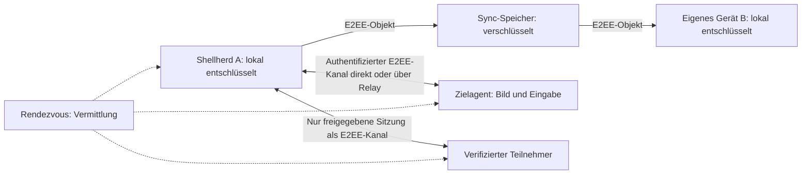

# Block 0: Bedrohungsmodell und Sicherheitsabnahme

Stand: 2026-10-29. Arbeitsentwurf; Anforderungen, keine bereits implementierten Garantien.
Übergeordneter [Arbeitsplan](selfhosted-e2ee.md).

Ergänzung aus Block 1: [Protokoll- und Offline-Sync-Entwurf](selfhosted-protocol.md). Die lokale Datei bleibt offline führend; Clients konsolidieren konkurrierende Änderungen nach Wiederverbindung. Prototypbeschränkungen zu Recovery, Verwaltungsautorität und Publikationsfreigaben stehen im Block-1-Entwurf.

## Stand der Befunde aus dem Review vom 2026-11-09

Härtung H1 setzt diese Befunde um (Spec `docs/superpowers/specs/2026-11-09-security-hardening-design.md`). Das ist keine Sicherheitsfreigabe und ersetzt keinen unabhängigen Review.

| Befund | Gegenstand | Stand |
| --- | --- | --- |
| M1 | Rate-Limits | Behoben im Server: Limits pro Quelle (`SHELLHERD_SERVER_TRUSTED_PROXY=1` hinter dem Proxy), Backoff bei Anmeldefehlern, Verbindungslimit je Adresse. Gegen verteilte Floods hilft nur ein privates Netz (WireGuard/Tailscale, H2). |
| M2 | Fingerabdruck-Vergleich per Checkbox | Behoben: getippte Prüfung beidseitig (12 Hex-Zeichen), Pinning geprüfter Geräte, genau ein DTLS-Fingerabdruck. Das 48-Bit-Präfix ist gegen einen rechenstarken Betreiber schwach (H2: Pinning der Noise-Statik). Die Prüfung schützt gegen einen bösartigen Server bei ehrlichem Renderer, nicht gegen einen kompromittierten Renderer. |
| M3 | Serverpasswort gleich Vault-Passwort | Behoben: Die Anmeldung prüft per Argon2id, dass beide verschieden sind, bevor etwas gesendet wird (Ausnahme: gesperrter Vault im Sync-Lab, Importfall). |
| M4 | Aufnahme ohne native Zustimmung, keine Permission-Handler, keine CSP, Tracks nicht erzwingbar beendbar | Behoben: Grant nur aus dem nativen Dialog im Main, Permission-Handler deny-by-default, CSP, Notbremse per Fensterneuladen nach 2 s. Wayland-Portal und Windows-Capture sind nicht manuell geprüft. |
| N1 | Fremdes Objekt blockiert den Sync | Behoben: übersprungen und gezählt; Client-Limits 100/32 MiB wie der Server. Fremde Objekte belegen weiter das Kontingent bis zur Kompaktierung (H2). |
| N2 | Registrierung ohne Besitznachweis | Behoben: Challenge mit statisch-ephemerem X25519-DH bei jeder Registrierung. |
| N4 | Schwache Passwörter, Aussperren des Besitzers | Behoben: Init schlägt generiertes Passwort vor, eigene Passwörter mindestens 16 Zeichen; Backoff statt globaler Sperre; konstantzeitiger Namensvergleich. Bestehende Konten behalten die Untergrenze 12. |
| N5 | Pins im Klartext | Behoben: Identitätsdatei v2 mit MAC. Rollback auf eine ältere gültige Datei bringt alte Pins zurück, eine v1-Datei stuft alle Pins auf ungeprüft zurück. |
| N6 | Image ohne Digest | Behoben: Basisimage per Digest (Tag und Datum im Dockerfile). Der Digest wird manuell erneuert (README, „Image aktualisieren“). |
| N7 | Consent-Spam | Behoben: 10 min Stummschaltung am Agent, eine offene Anfrage je Paar und 30 s Sperre nach Ablehnen am Server. |
| I4 | Rollenbindung im Kanal | Behoben (folgenlos). |
| I5 | Caddy `1MB` | Behoben: `1MiB`. |

## Umfang der ersten Ausbaustufe

Aktueller Sync-MVP: Eigene Geräte verwenden dieselbe Server-URL, Benutzername und Serverpasswort sowie das davon getrennte, ausschließlich lokale Vault-Passwort. Geräte-Fingerprintvergleich und Verwaltungsgeräte sind für diesen Kontomodus keine Voraussetzung. Der Linux-Entwicklungsprototyp bietet manuellen Datei-Sync; eine Produktivfreigabe liegt nicht vor. Die nachfolgenden Regeln für individuelle Geräteidentitäten, Kopplung und Widerruf gelten für die getrennten Geräteprotokoll-Experimente und späteren Fernzugriff. Anschließend folgen beaufsichtigter Fernzugriff und ausgewählte geteilte Sitzungen. Ein Herstellerkonto ist nicht erforderlich. Der lokale Betrieb ohne Server bleibt möglich.

Unbeaufsichtigter Zugriff, Zugriff auf Sperrbildschirm/UAC, Zwischenablage, Dateiübertragung, Aufzeichnung und gemeinsame Vaults mit anderen Personen sind eigene Erweiterungen. Sie erhalten keine implizite Freigabe durch die erste Geräteverknüpfung. Windows und Linux sind Zielplattformen; die genaue Versions-/Desktopmatrix wird vor Block 4 festgelegt.

Recovery-Vorschlag: Ein optionales, lokal erzeugtes Wiederherstellungsgeheimnis, das der Nutzer offline verwahrt. Ohne dieses oder ein verbleibendes berechtigtes Gerät keine Wiederherstellung. Format und Schlüsselhierarchie werden in Block 1 festgelegt. Keine Server-Hintertür.

## Schutzobjekte und Vertrauensgrenzen

| Bereich | Schutzobjekte / Verantwortung | Vertrauen |
| --- | --- | --- |
| Shellherd-Endgerät | Vault-Inhalte, lokale Schlüssel, freigegebene Sitzungen | Betriebssystem und ausführbarer Client müssen vertrauenswürdig sein; Renderer und empfangene Inhalte gelten als mögliche Angriffsflächen |
| Zielagent | Bildaufnahme, Eingabe, lokale Zustimmung, Zugriffsentscheidung | Nur ausdrücklich gekoppelte Geräte; privilegierte Funktionen getrennt vom Netzwerk-/Medienparser |
| Sync-/Rendezvous-Server | Verschlüsselte Objekte, Routing, Quoten | Für Vertraulichkeit, Teilnehmeridentität und Rechteentscheidungen nicht vertrauenswürdig |
| Relay / Proxy / Netzwerk | Weiterleitung und TLS-Terminierung | Sie dürfen die E2EE-Nutzdaten nicht entschlüsseln können |
| Andere Teilnehmer | Nur explizit freigegebene Ansichten und Eingaben | Kein impliziter Zugriff auf Vault, fremde Tabs oder weitere Zielgeräte |
| Image-Registry / Updatequelle | Software und Installationsartefakte | Auslieferung ist keine ausreichende Authentizitätsprüfung; Freigabeprüfung auf Endgerät erforderlich |
| Lokales Backup / Serverbackup | Verschlüsselte Daten und begrenzte Metadaten | Backupbetreiber besitzen keine Entschlüsselungsgeheimnisse |

Ein Angreifer darf Server und Netzwerk vollständig kontrollieren, Antworten verändern, Nachrichten wiederholen, Objekte austauschen, Geräteverzeichnisse fälschen und Verbindungen abbrechen. Er kann eigene Geräte anmelden und gültige, aber eingeschränkte Teilnehmerrechte besitzen. Verfügbarkeit gegenüber einem bösartigen Betreiber wird nicht garantiert.

Ein kompromittiertes berechtigtes Endgerät kann dessen entschlüsselte Daten lesen und erlaubte Aktionen ausführen. E2EE verhindert das nicht. Andere Geräte und nicht freigegebene Vaults müssen durch getrennte Schlüssel und Rechte möglichst abgegrenzt bleiben.

## Datenflüsse

1. **Koppeln:** Das neue Gerät erzeugt seine privaten Schlüssel lokal. Ein bereits berechtigtes Gerät verifiziert den neuen Gegenpart über einen unabhängigen Vergleich oder einen entsprechend abgesicherten Einladungsablauf. Eine vom Server gelieferte Geräte-ID oder ein Anzeigename genügt nicht. Erst nach Bestätigung wird genau der vorgesehene Zugriff eingerichtet.
2. **Sync:** Der Client verschlüsselt Inhalte und bindet deren Kontext, Herkunft und Version kryptografisch an das Objekt. Der Server sieht nur das notwendige äußere Format. Empfangende Geräte prüfen Authentizität, Rechte, Versionsbeziehungen und Größenlimits vor Übernahme. Konflikte bewahren beide Änderungen.
3. **Remote:** Vermittlung stellt Erreichbarkeit her; der Agent authentifiziert den Gegenpart und prüft lokale Rechte. Eine konkrete Sitzung erhält eigene Schlüssel und Zustimmung. Bild und Eingaben laufen E2EE direkt oder über einen Relay. Der Transportweg ändert die Prüfung nicht.
4. **Teilen:** Die Quelle gibt ausschließlich die ausgewählte Sitzung frei. Teilnehmer erhalten eigene, begrenzte Rechte und Sitzungszugriff. Einsehen einer Sitzung kann darin sichtbare Geheimnisse offenlegen. Steuerungsrecht umfasst gegebenenfalls Befehlsausführung mit den Rechten dieser Sitzung.
5. **Entziehen:** Das autorisierende Endgerät beendet die betroffene Sitzung lokal und verwirft deren Berechtigung. Künftige Daten verwenden aktualisierte Schlüssel und Mitgliedschaft. Ein Server darf Widerruf nicht eigenständig rückgängig machen.

## Sicherheitsregeln mit Prüf-IDs

| ID | Verbindliche Anforderung |
| --- | --- |
| SEC-01 | Keine privaten Endgeräteschlüssel, Vault-Passwörter, Vault-/Sitzungsschlüssel oder Klartext-Nutzdaten beim Server, Proxy, Relay oder in deren Backups |
| SEC-02 | Jedes Pairing bindet verifizierte Geräteidentität, Zweck und Rechte; Änderungen erfordern erneute autorisierte Prüfung |
| SEC-03 | Sync-, Identitäts- und Sitzungsschlüssel sind getrennt; Sitzungsfreigabe gewährt keinen Vault-Zugriff |
| SEC-04 | Manipulierte, kontextfremde, wiederholte oder veraltete Nachrichten werden nach dokumentierten Regeln verworfen; kein stiller Protokoll-Downgrade |
| SEC-05 | Datenänderungen und Konflikte werden authentifiziert; kein stiller Datenverlust oder Ersetzen neuerer bekannter Zustände |
| SEC-06 | Teilnehmer- und Steuerungsrechte werden am autorisierenden Endgerät durchgesetzt; Serverantworten allein erteilen keine Rechte |
| SEC-07 | Stoppen wirkt am Quellgerät sofort: keine weitere Bildfreigabe oder Eingabeannahme für die entzogene Sitzung; Wiederverbindung benötigt neue Autorisierung |
| SEC-08 | Keine Nutzinhalte oder Geheimnisse in Logs, temporären Dateien, Telemetrie, automatischen Crash-Uploads, URLs oder Prozessargumenten |
| SEC-09 | Empfangene Protokolldaten, Medien und Ressourcenanforderungen werden begrenzt; unberechtigte Clients erhalten weder Daten noch unbegrenzten Relay-Zugang |
| SEC-10 | Update-Authentizität und unterstützte Version werden unabhängig vom Vermittlungsserver geprüft; keine ungeprüfte Ausführung heruntergeladener Programme |
| SEC-11 | Recovery kann nur lokal durch berechtigte Geräte oder ein Nutzergeheimnis erfolgen; kein Administrations-Reset der Verschlüsselung |
| SEC-12 | Persistente Daten auf Clients sind verschlüsselt; notwendiger Klartext im Speicher ist begrenzt. OS-Swap, Dumps und lokale Exporte brauchen ein gesondertes Schutzkonzept |

## Angriffe und spätere Abnahmetests

Die folgenden Tests sind spezifiziert, noch nicht ausgeführt. Block 1 muss daraus konkrete Protokollfälle und Testvektoren machen; spätere Blöcke liefern Integrationstests.

| Fall | Angriff | Erwartetes Ergebnis / Prüfnachweis |
| --- | --- | --- |
| T01 | Betreiber kopiert Datenbank, Speicher, Proxy-/Relay-Mitschnitt und Backups | Keine Klartext-Testmarker oder privaten Nutzerschlüssel auffindbar; Entschlüsselung ohne Endgerät nicht möglich (SEC-01, 08) |
| T02 | Server ersetzt öffentlichen Geräteschlüssel oder fügt ein Gerät hinzu | Pairing bzw. Verbindungsaufbau scheitert ohne autorisierte Bestätigung; keine Datenfreigabe (SEC-02, 06) |
| T03 | Angreifer stiehlt oder verwendet Einladung erneut | Link allein erteilt keinen endgültigen Zugriff; Empfängerbindung/Bestätigung, Ablauf und einmalige Nutzung geprüft, einschließlich Rennen zwischen zwei Empfängern (SEC-02, 04) |
| T04 | Gekoppeltes Gerät geht verloren und wird widerrufen | Erreichbare Quellen beenden dessen Sitzungen und wechseln relevante Schlüssel; alte Berechtigungen gewähren keine neuen Daten (SEC-03, 07) |
| T05 | Server liefert alte Objekte, zweigt Historie ab oder spielt Backup zurück | Bereits bekannte Rückschritte/Abzweigungen werden erkannt, keine automatische Übernahme; Grenzen bei vollständig zurückgesetzten Clients sichtbar (SEC-04, 05) |
| T06 | Teilnehmer mit Leserecht sendet Eingaben, wechselt Ziel oder fordert Vault an | Quelle verwirft alle unberechtigten Operationen, auch bei gefälschten Serverrechten (SEC-03, 06) |
| T07 | Netzwerk fällt während Entzug aus; Server verschweigt Widerruf | Lokaler Stopp funktioniert ohne Server. Entfernte/offline Quellen dürfen nicht unbegrenzt auf alte Rechte vertrauen; Gültigkeits- und Erneuerungsregeln müssen Block 1 präzisieren (SEC-07) |
| T08 | Updatequelle oder Server bietet manipuliertes/älteres Agent-Paket an | Prüfung lehnt unzulässiges Paket vor Installation ab; separat autorisierter Recoverypfad dokumentiert (SEC-10) |
| T09 | Zwei eigene Geräte ändern offline denselben Vault | Beide Änderungen bleiben erhalten; Konflikt wird explizit aufgelöst, manipulierte Versionen abgewiesen (SEC-05) |
| T10 | Ungültige Medien, gigantische Payloads, viele Registrierungen/Relayversuche | Begrenzter Speicher/CPU/Traffic, kontrollierter Abbruch, keine Rechteausweitung (SEC-09) |
| T11 | Recovery über Support/Serveradmin oder ohne Nutzergeheimnis versucht | Kein Entschlüsseln möglich; mit legitimem Recoveryverfahren werden Geräte neu autorisiert (SEC-11) |
| T12 | Geheimnis-Testmarker bei Sync/Remote/Fehler/Abbruch verwendet | Inspektion von Logs, Tempdaten, Dumps/Uploadpfaden und Backups; keine Marker in unverschlüsselten persistenten Anwendungsartefakten (SEC-08, 12) |

## Grenzen, die das Produkt ausdrücklich benennen muss

- **Widerruf:** Ein offline befindliches Gerät kann einen Widerruf nicht sofort kennen. Block 1 muss kurze, begrenzte Freigaben und deren sichere Erneuerung spezifizieren. Bereits erhaltene Daten bleiben beim Empfänger. Fernsteuerung mit absichtlich verdecktem Widerruf benötigt eine messbare maximale Restgültigkeit.
- **Historie:** Ein vollständig zurückgesetztes oder neues Gerät kann ohne vertrauenswürdigen Vergleichspunkt nicht allein vom bösartigen Server erfahren, welches die neueste Historie ist. Pairing/Recovery müssen einen authentifizierten Vergleichspunkt übertragen oder den Zustand als ungeprüft behandeln. Ein aufgespaltener Serverzustand erfordert Geräteabgleich zur Erkennung.
- **Anonymität:** Pseudonyme Geräte sind keine anonymen Netzteilnehmer. Server sehen IP-Adressen, Verbindungszeiten und Datenmengen. Bei direkter Verbindung können Teilnehmer gegenseitig Netzwerkadressen erfahren. Ein späterer Relay-only-Modus kann diese Offenlegung zwischen Teilnehmern begrenzen.
- **Endgerät:** Keylogger, lokale Administratoren, Schadsoftware, Bildschirmaufzeichnung und kompromittierte Clients können zugängliche Inhalte lesen. Ein gestohlenes verschlüsseltes Vault ermöglicht Passwortversuche; Schutz hängt auch von Passwort und Schlüsselableitung ab.
- **Speicher:** Klartext wird auf berechtigten Endgeräten benötigt. JavaScript-Kopien, OS-Swap und Crashdumps verhindern eine pauschale Zusage, dass auf jedem System niemals Klartext auf einen Datenträger gelangt. Das wird vor Produktivfreigabe untersucht und dokumentiert.
- **Server:** Ein bösartiger Betreiber kann löschen, blockieren oder den Betrieb einstellen. Lokale verschlüsselte Backups und Offline-Betrieb begrenzen die Folgen.

## Metadateninventar und vorgeschlagene Voreinstellungen

Auch öffentliche Schlüssel und zufällige IDs können Geräte und Aktivitäten verknüpfen. Betreiberabweichungen lassen sich gegenüber einem bösartigen Betreiber nicht technisch ausschließen.

| Daten | Zweck | Vorgeschlagene Speicherung |
| --- | --- | --- |
| Öffentliche Geräteidentität, opake Routing-/Speicherzuordnung | Zustellung und Zugriffskontrolle | Nur solange registriert/benötigt; keine Klartextnamen, Hosts oder Credentialnamen |
| Verschlüsselte Sync-Objekte, technische Versionen, Größen | Sync und Konflikte | Definierte Quote und Versionsaufbewahrung; Löschung einschließlich Backupablauf dokumentieren |
| IP, Verbindungsstatus, Relay-Zuordnung | Aktive Zustellung | Nur im Arbeitsspeicher während Verbindung; begrenzte Missbrauchszähler mit Ablauf, keine standardmäßigen IP-Zugriffslogs |
| Einladungszustand | Einmaligkeit und Ablauf | Nur notwendiger nicht geheimer Nachweis; zeitlich begrenzt; keine Geheimnisse im Klartext |
| Metriken und technische Fehlercodes | Betrieb | Aggregiert ohne Geräte-/Sitzungs-IDs, Inhalte oder IP; Detaildiagnostik ausschließlich ausdrücklich aktiviert und weiter ohne Geheimnisse |
| Lokale Sicherheitsereignisse | Nachvollziehbare Freigaben und Entzug | Verschlüsselt auf dem autorisierenden Gerät, begrenzte Aufbewahrung; keine Eingaben oder Bildinhalte |

Reverse-Proxy, Ingress, Containerlogs und Monitoring gehören zur Prüfung. Eine sparsame Anwendung allein genügt nicht. Konkrete Quoten, Ablaufzeiten und Backupfristen werden in Block 2/7 festgelegt und getestet.

## Repository-Befund und offene Entscheidungen

Gelesen wurden `src/main/vault/crypto.ts`, `storage.ts`, `session.ts` und `src/main/update-check.ts`. Der Vault wird vor dem Dateischreiben verschlüsselt; beim Sperren wird der gehaltene Schlüsselbuffer überschrieben. Snapshots kopieren entschlüsselte Vault-Daten. Dies ist kein Nachweis vollständiger Speicherlöschung. Der bestehende Updatecheck meldet Releaseversionen; daraus folgt keine geprüfte Agent-Updatekette.

Für Block 1 zwingend aufzulösen:

1. Bestehendes Protokoll und Bibliotheken auswählen; authentifiziertes Pairing, Schlüsselhierarchie, Forward Secrecy für Sitzungen und Versionsbindung konkret nachweisen.
2. Rechte-/Mitgliedschaftsmodell einschließlich Offline-Widerruf, maximaler Restgültigkeit und sicherem Verhalten bei fehlender Aktualität spezifizieren.
3. Recovery-Vorschlag, Schutz lokaler Geräteschlüssel und Verhalten bei vollständig zurückgesetzten Clients festlegen.
4. Sync-Historie, Konflikte, authentifizierte Vergleichspunkte und Schutz gegen Kontexttausch spezifizieren.
5. Update-Vertrauensanker sowie Plan für unabhängigen Sicherheitsreview festlegen.

Block 0 liefert damit den Bedrohungsmodell-Entwurf und prüfbare Anforderungen. Die Produktauswahl zu Recovery und späterem Umfang geteilter Oberflächen bleibt als Arbeitsannahme sichtbar. Es wurden keine Sicherheitsgarantien implementiert oder Laufzeittests ausgeführt.

## Präzisierung: vereinfachter Kontosync

Der normale Sync verwendet Benutzername und Serverpasswort für Speicherzugriff, ohne Fingerprint oder Geräteaufnahme. Das separate Vault-Passwort wird niemals an den Server geschickt. Das Serverpasswort wird ausschließlich für Anmeldung über HTTPS (im lokalen Entwicklungstest Loopback-HTTP) kurzzeitig verarbeitet und nur als gesalzener Passwort-Hash provisioniert. Der Server kann diese Zugangsdaten deshalb sehen, aber keine Vault-Daten damit entschlüsseln. Wer das Serverkonto besitzt, kann verschlüsselte Versionen lesen und einstellen; die lokale Inhaltsprüfung bleibt zwingend. Es gibt damit zunächst keine individuelle Geräte-Sperre: Passwortwechsel und Sitzungswiderruf sind vor Produktivbetrieb zu vervollständigen. Bekannte Historienanker, Rollback-/Fork-Erkennung und gemeinsame Merge-Basen müssen auch im vereinfachten Weg authentifiziert werden; eine unverschlüsselte Serverliste genügt nicht.
